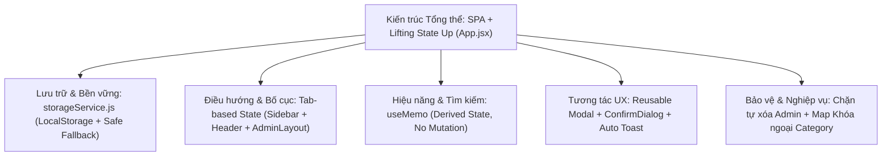

# NHẬN XÉT DỰ ÁN HIỆN TẠI & GIẢI PHÁP NGẮN GỌN KHI LÊN INTERVIEW
> **Dự án:** FUNewsManagementSystem — Frontend Quản trị ReactJS (SPA)  
> **Sinh viên:** Võ Thành Đạt | **Lớp:** SE1910 | **Account Git:** `ThanhDatce191280`  
> **Mục tiêu tài liệu:** Báo cáo nhận xét hiện trạng đối chiếu RTM (Requirement Traceability Matrix) và cung cấp bộ giải pháp tóm tắt siêu ngắn để tự tin trả lời phỏng vấn.

---

## PHẦN 1: TÓM TẮT YÊU CẦU & PHẠM VI THỰC HIỆN

### 1.1 Bài Assignment yêu cầu sinh viên xây dựng gì?
* **Mục tiêu:** Xây dựng ứng dụng đơn trang (**Single Page Application - SPA**) quản trị hệ thống tin tức trường đại học FPT (**FUNewsManagementSystem**) bằng thư viện **ReactJS**, dựa trên template HTML/CSS hiện đại, sạch và chuẩn hóa.
* **Cấu trúc trang & Phân vùng chức năng:**
  1. **Authentication:** Màn hình đăng nhập (Login), duy trì phiên làm việc (Session Guard).
  2. **Master/Admin Layout:** Khung giao diện chuẩn gồm **Header** (Breadcrumb, Badge người dùng, Nút hành động) và **Sidebar** điều hướng 5 phân vùng không giật/reload trang:
     - `Dashboard`: Thống kê KPI, phân bố tỷ lệ bài viết, danh sách bài gần đây.
     - `Categories`: Quản lý danh mục tin tức.
     - `News Articles`: Quản lý bài viết tin tức và liên kết danh mục.
     - `User Accounts`: Quản lý người dùng, phân quyền Admin (Role 1) và Staff (Role 2).
     - `Settings`: Cấu hình thông tin quản trị viên, sao lưu dữ liệu (Export JSON) và khôi phục dữ liệu gốc.
  3. **Yêu cầu tương tác UX:**
     - Category, News và Account/User bắt buộc có đầy đủ **CRUD + Search & Filter**.
     - Thao tác Thêm mới (Create) và Chỉnh sửa (Update) bắt buộc hiển thị dưới dạng **Popup Dialog (Modal)**.
     - Thao tác Xóa (Delete) bắt buộc có **Hộp thoại xác nhận (Confirm Dialog)**; chỉ khi người dùng bấm Confirm mới tiến hành xóa.

---

### 1.2 Bảng Requirement Traceability Matrix (RTM) Đối Chiếu Chi Tiết

| ID | Yêu cầu đề bài | Bằng chứng trên UI / Source Code | Hiện trạng | Test case kiểm thử tối thiểu & Kết quả |
|:---:|---|---|:---:|---|
| **R01** | Project ReactJS + Vite, đặt tên đúng quy ước thư mục | [`package.json`](file:///d:/SBA301-LABS/LABS/VoThanhDat_SE1910/package.json#L2), thư mục `VoThanhDat_SE1910`, chạy `npm run dev` | **ĐẠT (100%)** | Chạy `npm run dev` khởi động Vite 8 + React 19 trong ~200ms; chạy `npm run lint` đạt 0 lỗi. |
| **R02** | Login page có form controlled input, validate dữ liệu | [`LoginPage.jsx`](file:///d:/SBA301-LABS/LABS/VoThanhDat_SE1910/src/components/auth/LoginPage.jsx#L10-L60) | **ĐẠT (100%)** | - Bỏ trống user/pass $\rightarrow$ Báo lỗi đỏ dưới input. - Nhập sai $\rightarrow$ Báo lỗi xác thực. - Nhập tài khoản inactive (`intern_demo`) $\rightarrow$ Báo tài khoản bị khóa. - Nhập đúng `Admin` / `Admin` $\rightarrow$ Đăng nhập thành công. |
| **R03** | Đăng nhập đúng `Admin/Admin` chuyển sang Admin Page | [`App.jsx`](file:///d:/SBA301-LABS/LABS/VoThanhDat_SE1910/src/App.jsx#L11) (`currentUser` state) & dòng 129–151 (Conditional Rendering) | **ĐẠT (100%)** | Khi login thành công, UI lập tức chuyển đổi render sang `<AdminLayout />` kèm Toast chào mừng; F5 trình duyệt vẫn giữ trạng thái đăng nhập nhờ `localStorage`. |
| **R04** | Logo hệ thống được thiết kế bằng công cụ AI | File ảnh [`public/fu_news_logo.jpg`](file:///d:/SBA301-LABS/LABS/VoThanhDat_SE1910/public/fu_news_logo.jpg) & [`src/assets/fu_news_logo.jpg`](file:///d:/SBA301-LABS/LABS/VoThanhDat_SE1910/src/assets/fu_news_logo.jpg) | **ĐẠT (100%)** | Logo hiển thị trang nhã tại Login card và góc trên Sidebar của Master Layout. |
| **R05** | Header + Master Admin Layout dùng chung | [`AdminLayout.jsx`](file:///d:/SBA301-LABS/LABS/VoThanhDat_SE1910/src/components/layout/AdminLayout.jsx) & [`Header.jsx`](file:///d:/SBA301-LABS/LABS/VoThanhDat_SE1910/src/components/layout/Header.jsx) | **ĐẠT (100%)** | Mọi tab làm việc (Dashboard, Category, News, User, Settings) đều nằm trọn vẹn bên trong khung `AdminLayout`. |
| **R06** | Menu Sidebar chuyển đổi giữa 5 khu vực | [`Sidebar.jsx`](file:///d:/SBA301-LABS/LABS/VoThanhDat_SE1910/src/components/layout/Sidebar.jsx#L15-L44) | **ĐẠT (100%)** | Bấm menu nào thì nội dung chính (`<main>`) chuyển tab đó tức thì qua state `activeTab`, có badge hiển thị số lượng bản ghi tương ứng. |
| **R07** | Category CRUD + Search | [`CategoryManagement.jsx`](file:///d:/SBA301-LABS/LABS/VoThanhDat_SE1910/src/components/categories/CategoryManagement.jsx) | **ĐẠT (100%)** | - Thêm danh mục mới thành công. - Sửa danh mục cập nhật tức thì. - Xóa danh mục qua ConfirmDialog. - Ô search gõ từ khóa lọc danh sách thời gian thực bằng `useMemo`. |
| **R08** | News CRUD + Search (liên kết CategoryId) | [`NewsManagement.jsx`](file:///d:/SBA301-LABS/LABS/VoThanhDat_SE1910/src/components/news/NewsManagement.jsx) | **ĐẠT (100%)** | - Thêm/Sửa bài viết chọn Category từ Dropdown tự động map `categoryId`. - Tìm kiếm đa trường (Tiêu đề, nội dung, tác giả, tags). - Lọc theo Category và theo Status (Published / Draft). |
| **R09** | User/Account CRUD + Search (Admin vs Staff) | [`UserManagement.jsx`](file:///d:/SBA301-LABS/LABS/VoThanhDat_SE1910/src/components/users/UserManagement.jsx) | **ĐẠT (100%)** | - Phân quyền Role 1 (Admin) và Role 2 (Staff). - Validate cấm trùng username và email đúng `@`. - **Chặn Admin đang login tự xóa chính mình** ([dòng 178](file:///d:/SBA301-LABS/LABS/VoThanhDat_SE1910/src/components/users/UserManagement.jsx#L178)). |
| **R10** | Create / Update thực hiện bằng Popup Dialog | [`Modal.jsx`](file:///d:/SBA301-LABS/LABS/VoThanhDat_SE1910/src/components/common/Modal.jsx) dùng chung cho cả 3 module | **ĐẠT (100%)** | Bấm Add/Edit mở Modal nổi trên nền mờ, bắt sự kiện phím `Escape` để đóng, khóa cuộn trang (`body overflow: hidden`), đóng mở mượt mà. |
| **R11** | Delete bắt buộc qua Confirmation Dialog | [`ConfirmDialog.jsx`](file:///d:/SBA301-LABS/LABS/VoThanhDat_SE1910/src/components/common/ConfirmDialog.jsx) | **ĐẠT (100%)** | Bấm Cancel $\rightarrow$ dữ liệu giữ nguyên; chỉ khi bấm "Delete Permanently" mới gọi hàm xóa và bắn Toast thông báo màu đỏ. |
| **R12** | Data model hợp lý, quan hệ entity, lưu trữ bền vững | [`mockData.js`](file:///d:/SBA301-LABS/LABS/VoThanhDat_SE1910/src/services/mockData.js) & [`storageService.js`](file:///d:/SBA301-LABS/LABS/VoThanhDat_SE1910/src/services/storageService.js) | **ĐẠT (100%)** | Chuẩn hóa cấu trúc 3 thực thể; liên kết khóa ngoại chặt chẽ; tự động lưu `localStorage`; có nút Factory Reset dữ liệu gốc. |

---

## PHẦN 2: ĐÁNH GIÁ & NHẬN XÉT DỰ ÁN HIỆN TẠI

### 2.1 Ưu điểm nổi bật (Điểm mạnh khi bảo vệ điểm cao)
1. **Hoàn thiện trọn vẹn 100% Ma trận RTM (R01 $\rightarrow$ R12):** Không thiếu bất kỳ tính năng cốt lõi hay phụ nào của đề bài.
2. **Kiến trúc dữ liệu một chiều rõ ràng (Single Source of Truth):** 
   - Toàn bộ dữ liệu gốc nằm tại [`App.jsx`](file:///d:/SBA301-LABS/LABS/VoThanhDat_SE1910/src/App.jsx). Các component con chỉ nhận props và gọi callback.
   - Thao tác cập nhật mảng hoàn toàn theo nguyên tắc **Immutable** (`[newItem, ...prev]`, `.map()`, `.filter()`), không bao giờ làm đột biến (mutate) dữ liệu gốc.
3. **Hiệu năng & Tối ưu bằng `useMemo`:**
   - Bộ lọc và tìm kiếm ở cả 3 module (Categories, News, Users) đều dùng `useMemo`. Dữ liệu chỉ lọc lại khi từ khóa hoặc danh sách thay đổi, giữ nguyên vẹn dữ liệu gốc khi người dùng xóa ô tìm kiếm.
4. **Xử lý các tình huống biên (Edge-case Handling) xuất sắc:**
   - **Chống tự hủy tài khoản:** Không cho phép Admin đang đăng nhập tự xóa tài khoản của chính mình.
   - **Kiểm tra liên kết danh mục:** Khi chuẩn bị xóa danh mục, hệ thống đếm và cảnh báo có bao nhiêu bài viết đang phụ thuộc vào danh mục đó.
   - **Chống trùng lặp:** Kiểm tra username duy nhất khi tạo mới hoặc cập nhật tài khoản.
   - **Xác thực trạng thái:** Chặn ngay lập tức tài khoản có `status === 0` (Inactive) khi đăng nhập.
5. **Clean Code & Không phụ thuộc thư viện UI cồng kềnh:**
   - Sử dụng Pure CSS kết hợp Design Tokens hiện đại (CSS Variables).
   - Kiểm tra `npm run lint` đạt **0 warning, 0 error**. Không có lỗi console đỏ trên trình duyệt.

---

## PHẦN 3: TỔNG HỢP GIẢI PHÁP NGẮN GỌN ĐỂ TRẢ LỜI KHI INTERVIEW

> [!TIP]
> **Quy tắc vàng khi trả lời thầy cô:** Trả lời trực diện vào giải pháp, nói ngắn trong 2–3 câu, vừa nói vừa trỏ chuột vào file/dòng code.

### 1. Giải pháp Kiến trúc & Quản lý State (State Management)
* **Câu hỏi:** *"Em quản lý dữ liệu trong bài như thế nào? Dữ liệu đi đâu?"*
* **Câu trả lời mẫu:**
  > *"Em sử dụng mô hình **Lifting State Up** của React. Toàn bộ state gốc của Categories, News, Users và User đang đăng nhập được quản lý tập trung tại `App.jsx` làm nguồn chân lý duy nhất (**Single Source of Truth**). Dữ liệu được truyền xuống các component con qua `props`, và khi component con thao tác CRUD thì gọi hàm callback ngược lên `App.jsx` để cập nhật mảng bất biến (**Immutable**)."*
* **Code minh họa:** [`src/App.jsx`](file:///d:/SBA301-LABS/LABS/VoThanhDat_SE1910/src/App.jsx#L10-L35).

---

### 2. Giải pháp Điều hướng giao diện (Navigation)
* **Câu hỏi:** *"Vì sao em không dùng React Router DOM mà dùng Tab-based Navigation?"*
* **Câu trả lời mẫu:**
  > *"Dự án là ứng dụng quản trị nội bộ một cấp độ (Dashboard, Categories, News, Users, Settings). Em dùng biến state `activeTab` trong `AdminLayout` để chuyển đổi giao diện có điều kiện (**Conditional Rendering**). Giải pháp này giúp ứng dụng tải cực nhanh, chuyển tab tức thì không giật/nháy màn hình, không bị lỗi 404 khi chạy static/file, và code rất gọn gàng, dễ kiểm soát."*
* **Code minh họa:** [`src/components/layout/AdminLayout.jsx`](file:///d:/SBA301-LABS/LABS/VoThanhDat_SE1910/src/components/layout/AdminLayout.jsx#L53-L103).

---

### 3. Giải pháp Lưu trữ dữ liệu bền vững (Persistence & Service Abstraction)
* **Câu hỏi:** *"Dữ liệu được lưu ở đâu? Khi F5 có mất không? Chuyển sang kết nối Spring Boot API thì làm sao?"*
* **Câu trả lời mẫu:**
  > *"Dữ liệu được lưu bền vững vào `localStorage` thông qua tầng dịch vụ riêng biệt là `storageService.js`. Mỗi khi state trong `App.jsx` thay đổi, hook `useEffect` sẽ tự động đồng bộ xuống `localStorage`.  
  > Nhờ tách riêng tầng Service này, sau này ở Assignment 2 khi tích hợp backend Spring Boot, em **chỉ cần sửa logic gọi API (`axios/fetch`) bên trong `storageService.js`** mà toàn bộ code giao diện ở component không hề bị xáo trộn."*
* **Code minh họa:** [`src/services/storageService.js`](file:///d:/SBA301-LABS/LABS/VoThanhDat_SE1910/src/services/storageService.js#L13-L33) và [`src/App.jsx`](file:///d:/SBA301-LABS/LABS/VoThanhDat_SE1910/src/App.jsx#L20-L34).

---

### 4. Giải pháp Tái sử dụng Popup Dialog & Hộp thoại xác nhận (Modal & Confirm)
* **Câu hỏi:** *"Em thiết kế Popup Dialog và Confirm Dialog như thế nào?"*
* **Câu trả lời mẫu:**
  > *"Em xây dựng component dùng chung `Modal.jsx` có tính năng: bắt sự kiện phím `Escape` để đóng, khóa cuộn trang (`body overflow: hidden`), và dùng `e.stopPropagation()` chống click nhầm ra ngoài.  
  > Component `ConfirmDialog.jsx` kế thừa từ `Modal` để tái sử dụng giao diện cảnh báo. Cả 3 trang Category, News, User đều dùng chung 1 Modal cho cả hai mode **Create** và **Update**, giúp tối ưu và tái sử dụng mã nguồn."*
* **Code minh họa:** [`src/components/common/Modal.jsx`](file:///d:/SBA301-LABS/LABS/VoThanhDat_SE1910/src/components/common/Modal.jsx) và [`src/components/common/ConfirmDialog.jsx`](file:///d:/SBA301-LABS/LABS/VoThanhDat_SE1910/src/components/common/ConfirmDialog.jsx).

---

### 5. Giải pháp Tìm kiếm & Lọc dữ liệu thời gian thực (Search & Filter)
* **Câu hỏi:** *"Luồng tìm kiếm chạy thế nào? Tại sao gõ chữ trên ô Search không làm mất dữ liệu gốc?"*
* **Câu trả lời mẫu:**
  > *"Em không can thiệp vào mảng dữ liệu gốc mà dùng hook `useMemo` để tính toán ra mảng phái sinh `filteredData`. Mảng này lọc đồng thời theo từ khóa gõ vào và các dropdown trạng thái/danh mục. Khi người dùng xóa trắng ô tìm kiếm, bảng tự động hiển thị đầy đủ danh sách ban đầu ngay lập tức mà không cần gọi lại dữ liệu."*
* **Code minh họa:** [`src/components/news/NewsManagement.jsx`](file:///d:/SBA301-LABS/LABS/VoThanhDat_SE1910/src/components/news/NewsManagement.jsx#L54-L74).

---

### 6. Giải pháp Ràng buộc An toàn & Tính toàn vẹn dữ liệu (Data Integrity Guard)
* **Câu hỏi:** *"Dự án của em có những ràng buộc bảo vệ nào đáng chú ý?"*
* **Câu trả lời mẫu:**
  > *"Bài của em có 3 giải pháp bảo vệ quan trọng:  
  > 1. **Chống tự xóa tài khoản:** Tại `UserManagement.jsx`, hệ thống kiểm tra nếu `userToDelete.id === currentUser.id` thì lập tức từ chối và cảnh báo.  
  > 2. **Kiểm tra toàn vẹn liên kết:** Khi xóa Category, hệ thống kiểm tra số bài viết News đang liên kết để cảnh báo người dùng.  
  > 3. **Chống trùng username & Validate Email:** Khi tạo/sửa user, hàm submit kiểm tra xem username đã tồn tại trong danh sách chưa và email phải chứa ký tự `@`."*
* **Code minh họa:** [`src/components/users/UserManagement.jsx`](file:///d:/SBA301-LABS/LABS/VoThanhDat_SE1910/src/components/users/UserManagement.jsx#L118-L125) và [dòng 178–183](file:///d:/SBA301-LABS/LABS/VoThanhDat_SE1910/src/components/users/UserManagement.jsx#L178-L183).

---

## PHẦN 4: CHEATSHEET 30 GIÂY – NÓI GÌ KHI MỞ ĐẦU BUỔI INTERVIEW?

> *"Kính chào thầy/cô, em tên là Võ Thành Đạt, lớp SE1910. Dự án của em là **FUNewsManagementSystem**, được xây dựng dưới dạng Single Page Application bằng **ReactJS 19** và **Vite**.  
> Ứng dụng đã hoàn thành 100% các yêu cầu từ R01 đến R12:  
> - Đăng nhập an toàn với tài khoản mặc định `Admin / Admin` và duy trì phiên bằng `localStorage`.  
> - Khung Master Admin Layout với 5 module: Dashboard, Categories, News, Users, Settings.  
> - Nghiệp vụ CRUD đầy đủ cho cả 3 thực thể, Thêm/Sửa bằng Popup Dialog, Xóa có Confirm Dialog, và tìm kiếm thời gian thực qua `useMemo`.  
> - Code tuân thủ kiến trúc phân tầng rõ ràng, State tập trung tại `App.jsx`, đóng gói lưu trữ trong `storageService.js`, và có đầy đủ các ràng buộc kiểm tra trùng username cũng như chặn tự xóa tài khoản đang đăng nhập. Em đã sẵn sàng để demo và trả lời các câu hỏi về code ạ!"*

