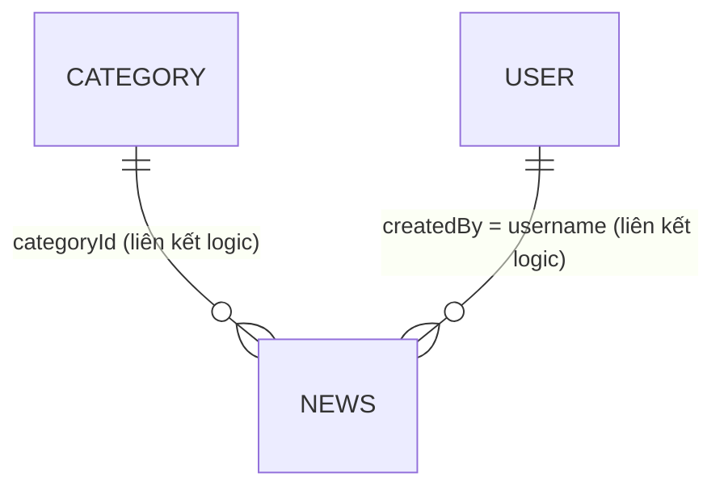
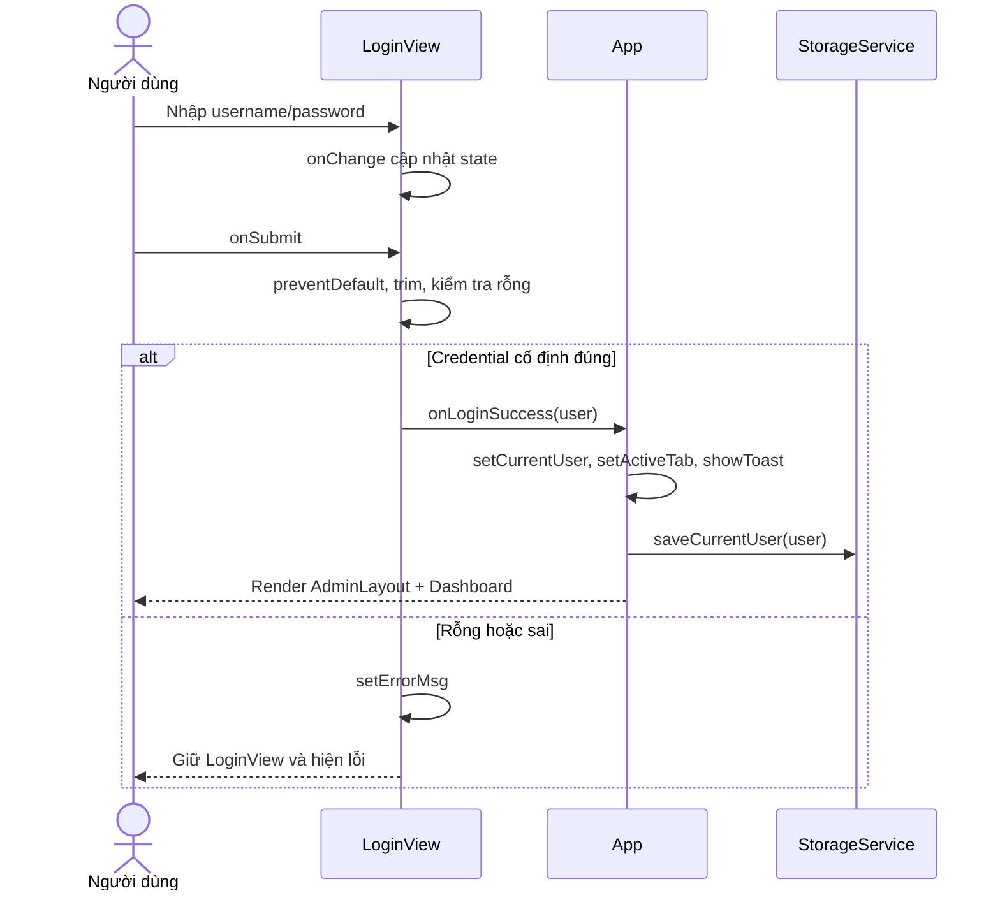

<!-- DuyDLH-CE200667 -->
# SBA301 Assignment 01 - Tài liệu giải thích hệ thống và luyện interview

> **Cập nhật sau buổi luyện interview:** Login đã được sửa để gọi `StorageService.authenticate`, đọc tài khoản đang lưu thay cho hai nhánh credential cố định. Username được trim và so không phân biệt hoa thường; password được trim, so phân biệt hoa thường. Tài khoản phải có status=1 và role=1/2. Tạo/sửa/xóa account và đổi password nay ảnh hưởng lần login kế tiếp. Session không chứa password. `guest_writer` mẫu vẫn status=0: cần Admin bật Hoạt động trong Users rồi mới đăng nhập. Những phần bên dưới nói “login hard-code”, “không đọc users”, “tạo user không đăng nhập được” và test expected tương ứng là mô tả phiên bản trước, đã được thay thế bởi cập nhật này. Luồng mới: LoginView validate rỗng → StorageService.authenticate → kiểm tra credential/status/role → trả user/error → App.handleLoginSuccess lưu session và render Dashboard. Các liên kết số dòng cũ có thể dịch chuyển sau bản sửa; tìm theo tên hàm khi cần. Chặn role ở App/action và thu hồi session đang mở khi account bị khóa vẫn chưa được bổ sung.

**Sinh viên:** Đào Lê Hoàng Duy - CE200667  
**Project đang đối chiếu:** DuyDLH_CE200667 / FUNewsManagementSystem  
**Ngày đối chiếu:** 30/10/2026  
**Phạm vi:** React frontend, mock authentication và localStorage; chưa có Spring Boot API/database.

## Cách dùng tài liệu

Đây là tài liệu luyện giải thích dựa trên source hiện tại. Các đoạn “Trả lời mẫu” dùng ngôi “em” để tập nói; cần mở code, chạy lại và diễn đạt bằng hiểu biết của mình. Các câu hỏi là dự kiến theo hướng dẫn và source, không phải danh sách chắc chắn giảng viên sẽ hỏi.

Phân biệt ba loại thông tin xuyên suốt tài liệu:

- **Theo hướng dẫn:** yêu cầu hoặc cách đánh giá được nêu trong hai PDF.
- **Code hiện tại:** hành vi nhìn thấy trong source đã kiểm tra.
- **Đề xuất thay đổi:** cách nâng cấp để luyện adaptation, chưa được triển khai chỉ vì xuất hiện trong tài liệu này.

Không dùng tên ở đầu file làm bằng chứng duy nhất về tác giả. Interview guide quan tâm Git cá nhân, tiến trình thật, khả năng trace code và giải thích thay đổi. Không tạo lại lịch sử giả hoặc nhận đã kiểm thử một trường hợp chưa chạy.

## Mục lục

1. [Hai rubric và cách chuẩn bị](#1-hai-rubric-và-cách-chuẩn-bị)
2. [Bài giới thiệu và kịch bản demo](#2-bài-giới-thiệu-và-kịch-bản-demo)
3. [Yêu cầu và tình trạng đáp ứng](#3-yêu-cầu-và-tình-trạng-đáp-ứng)
4. [Kiến trúc, dữ liệu và state](#4-kiến-trúc-dữ-liệu-và-state)
5. [Trace các luồng hệ thống](#5-trace-các-luồng-hệ-thống)
6. [Ngân hàng câu hỏi và trả lời](#6-ngân-hàng-câu-hỏi-và-trả-lời)
7. [Những điểm dễ bị hỏi xoáy](#7-những-điểm-dễ-bị-hỏi-xoáy)
8. [Luyện sửa yêu cầu](#8-luyện-sửa-yêu-cầu)
9. [Test matrix và bằng chứng](#9-test-matrix-và-bằng-chứng)
10. [Debug và lỗi thực tế](#10-debug-và-lỗi-thực-tế)
11. [Git cá nhân và AI usage](#11-git-cá-nhân-và-ai-usage)
12. [Luyện interview theo thời gian](#12-luyện-interview-theo-thời-gian)
13. [Nguồn đối chiếu](#13-nguồn-đối-chiếu)
14. [Mở nhanh code theo vị trí](#14-mở-nhanh-code-theo-vị-trí)

## 1. Hai rubric và cách chuẩn bị

### 1.1. Rubric Assignment 01: 8 tiêu chí, tổng 10 điểm

Theo Student Guide, trang 16-17:

| Tiêu chí | Điểm tối đa | Nên mở bằng chứng gì? |
|---|---:|---|
| Problem Understanding | 1.0 | Requirement map, mô hình dữ liệu, constraint |
| Solution Design & Reasoning | 1.5 | Component tree, state ownership, lý do thiết kế |
| Implementation | 2.0 | Demo login, menu, CRUD, search, dialog |
| Testing & Verification | 1.5 | Test matrix có expected/actual và evidence |
| Debugging & Problem Solving | 1.5 | Triệu chứng, root cause, bản sửa, retest |
| Code Explanation | 1.0 | Mở đúng file và giải thích luồng |
| Modification / Transfer Task | 1.0 | Impact analysis, thay đổi nhỏ, kiểm thử |
| AI Usage & Engineering Practice | 0.5 | Khai báo hỗ trợ AI và cách kiểm chứng |

### 1.2. Rubric interview chung: 4 tiêu chí, tổng 10 điểm

Theo Interview Guide, trang 2-3:

| Mã | Tiêu chí | Điểm tối đa | Cách chuẩn bị |
|---|---|---:|---|
| C1 | Problem Understanding & Solution Approach | 1.5 | Nói rõ mục tiêu, entity, luồng và cách tổ chức |
| C2 | Individual Engineering Process & Personal Git Evidence | 2.0 | Repo đúng tài khoản, commit thể hiện tiến trình thật |
| C3 | Functional Implementation | 1.5 | Chạy lại được, demo workflow chính |
| C4 | Code Understanding, Explanation & Adaptation | 5.0 | Trace state/event, giải thích quyết định và change impact |

Hai bảng này được trình bày riêng trong tài liệu; không cộng thành 20 điểm và không tự kết luận công thức gộp. Cách giảng viên áp dụng thực tế cần theo thông báo của lớp. Interview guide nói live modification có thể không cần nếu phần trả lời đã đủ chứng minh mức độ hiểu.

### 1.3. Khung trả lời một câu hỏi code

**Mục đích → Đầu vào → Sự kiện kích hoạt → Xử lý/state → Kết quả → Nhánh lỗi → Lý do → Ảnh hưởng nếu đổi yêu cầu.**

Ví dụ với Create Category:

> “Chức năng này thêm danh mục. Input là `formData` trong `CategoryModal`. Submit gọi `handleSubmit`, chặn submit mặc định, validate tên rỗng và tên trùng. Nếu hợp lệ, modal gọi callback lên `CategoryView`, rồi đến `handleAddCategory` của `App`. App tạo id, tạo mảng mới, cập nhật state và lưu localStorage. Danh sách render lại, modal đóng, toast xuất hiện. Nếu tên không hợp lệ thì form giữ nguyên và hiện lỗi. Em đặt data ở App để Dashboard, Sidebar và News cùng đọc được. Nếu chuyển sang API, em phải xử lý thêm async, trạng thái chờ và lỗi trước khi đóng modal.”

## 2. Bài giới thiệu và kịch bản demo

### 2.1. Bài nói mở đầu khoảng 90 giây

> “Em là Đào Lê Hoàng Duy, MSSV CE200667. Bài Assignment 01 của em là frontend quản trị FUNewsManagementSystem bằng React và Vite, sử dụng Bootstrap cho giao diện và Lucide cho icon.
>
> Hệ thống có trang đăng nhập và layout quản trị dùng chung. Sau khi đăng nhập Admin/Admin, người dùng vào Dashboard, có thể quản lý danh mục, tin tức, tài khoản và mở Settings. Ba màn hình quản lý đều có đọc danh sách, tạo mới, cập nhật, xóa có xác nhận và tìm kiếm. Create và Update dùng popup dialog.
>
> Em tổ chức dữ liệu dùng chung ở App. Các view nhận danh sách và callback qua props. Form giữ dữ liệu nhập và lỗi validation tại modal. Khi lưu, form gửi payload lên view, view xác định Create hay Update rồi gọi handler ở App. Handler tạo mảng mới, cập nhật state, lưu localStorage và hiển thị toast.
>
> Bài hiện dùng mock authentication và dữ liệu trình duyệt, chưa có backend. Em chọn cách này vì Assignment 01 chưa bắt buộc Spring Boot/database thật. Một số giới hạn em xác định là login chưa đọc danh sách tài khoản CRUD, kiểm soát Staff mới ở menu, và việc xóa danh mục đang được bài viết sử dụng cần có policy chặt hơn. Em có thể mở source để giải thích từng luồng và cách cải tiến.”

Chỉ trình bày về lịch sử phát triển, kiểm thử cá nhân và nguồn logo khi có bằng chứng thật.

### 2.2. Chạy project đúng thư mục

```powershell
Set-Location 'D:\File\Ki_7\SBA301\labs\HoangDuy_SBA_Assignment_2\frontend'
npm install
npm run dev
```

Khi đã cài dependency, có thể chạy ngay `npm run dev`. Mở địa chỉ Vite in ra terminal; cổng có thể khác nếu cổng mặc định bận. Dừng bằng `Ctrl+C`.

```powershell
npm run build
npm run lint
npm run preview
```

`preview` dùng sau build để xem bản build cục bộ. Nó không triển khai lên Internet. Không chạy npm ở thư mục cha `ASSIGNMENT_1` vì `package.json` nằm trong thư mục `DuyDLH_CE200667`.

### 2.3. Demo 7-10 phút

| Thứ tự | Thao tác | Điều cần giải thích |
|---|---|---|
| 1 | Mở project, chạy dev | Chỉ script trong package.json |
| 2 | Mở Git cá nhân nếu có | Account, commit thật và một diff tiêu biểu |
| 3 | Submit login rỗng, sai, rồi Admin/Admin | Validation trước, mock credential sau |
| 4 | Đi qua đủ 5 menu | `activeTab` đổi; không full reload |
| 5 | Category: Add → invalid → valid → Edit | Form state, selected item, mode |
| 6 | Search tên vừa tạo, bỏ search | Source list không bị thay thế |
| 7 | Delete → Cancel, rồi Delete → Confirm | Callback xóa chỉ chạy khi xác nhận |
| 8 | News: tạo bài thuộc category đang tồn tại | `categoryId`, `createdBy`, tags và status |
| 9 | Users: tạo username trùng/email sai, rồi hợp lệ | Uniqueness, email validation, role |
| 10 | Settings: theme, reload | Theme và dữ liệu được hydrate từ storage |
| 11 | Logout | Xóa session, giữ dữ liệu và preference |

Nên tạo một category và news thử nghiệm có tên rõ ràng để không phá dữ liệu cần trình bày. Factory Reset ghi đè cả dữ liệu mẫu; tránh bấm nếu chưa muốn bỏ thay đổi.

## 3. Yêu cầu và tình trạng đáp ứng

Các ID dưới đây theo Student Guide, trang 4. “Có trong source” chưa đồng nghĩa đã chạy test UI đầy đủ.

| ID | Yêu cầu | Bằng chứng trong project | Nhận xét chính xác |
|---|---|---|---|
| R01 | React + Vite; tên project theo quy ước | package.json, vite.config.js, folder | Có React/Vite; cần xác nhận `CE200667` có phù hợp phần ClassCode theo lớp hay chỉ là MSSV |
| R02 | Login page | LoginView | Có username/password và thông báo lỗi |
| R03 | Admin/Admin vào trang quản trị | LoginView.handleSubmit, App.currentUser | Có mock login và conditional rendering |
| R04 | Logo tạo bằng AI | src/assets/logo.svg, Sidebar và LoginView | Có asset logo; source không chứng minh nguồn tạo bằng AI; Header hiện là breadcrumb/profile |
| R05 | Header và master layout | AdminLayout, Header, Sidebar | Có layout dùng chung và children |
| R06 | Đủ 5 menu | Sidebar.menuItems, App.activeTab | Có Dashboard/Category/News/Users/Settings; Users bị disable với Staff |
| R07 | Category CRUD + Search | CategoryView, CategoryModal, App | Có; xóa category có bài chỉ cảnh báo, chưa giữ toàn vẹn relation |
| R08 | News CRUD + Search | NewsView, NewsModal, App | Có; search title/content/tags, filter category/status |
| R09 | User CRUD + Search | UserView, UserModal, App | Có; không tích hợp danh sách này với login |
| R10 | Create/Update bằng dialog | Modal và ba form modal | Có dùng lại form theo mode |
| R11 | Xác nhận trước Delete | ConfirmDialog và state item cần xóa | Có; Cancel không gọi callback xóa |
| R12 | Data model hợp lý | initialData, StorageService | Có entity/role/status; relation và schema storage còn hạn chế |

**Phạm vi không bắt buộc theo hướng dẫn:** backend Spring Boot thật, database thật, JWT production và triển khai production. Đây là phạm vi bài; không có nghĩa frontend mock đủ an toàn để dùng thật.

## 4. Kiến trúc, dữ liệu và state

### 4.1. Component tree thực tế

```text
index.html (#root)
└─ main.jsx: createRoot + StrictMode + import Bootstrap/CSS
   └─ App
      ├─ chưa có currentUser: LoginView
      ├─ có currentUser: AdminLayout
      │  ├─ Sidebar
      │  ├─ Header
      │  └─ children: một view theo activeTab
      │     ├─ DashboardView
      │     ├─ CategoryView → CategoryModal → Modal
      │     │                └─ ConfirmDialog / EmptyState
      │     ├─ NewsView → NewsModal → Modal
      │     │            └─ ConfirmDialog / EmptyState
      │     ├─ UserView → UserModal → Modal
      │     │            └─ ConfirmDialog / EmptyState
      │     └─ SettingsView → ConfirmDialog
      └─ Toast: render ở cả nhánh login và nhánh admin
```

`ConfirmDialog` và `EmptyState` là thành phần view dùng khi cần, không phải con của form modal. Sơ đồ nhóm chúng theo màn hình sở hữu.

### 4.2. Trách nhiệm từng nhóm file

| Nhóm | Trách nhiệm | Không nên giải thích nhầm |
|---|---|---|
| main.jsx | Entry point React, import CSS | Không chứa CRUD |
| App.jsx | Shared state, auth, tab, CRUD, toast, theme | Đây là nơi xử lý CRUD chính hiện tại |
| views | Hiển thị, search/filter, chọn item, mở dialog | Không tự sở hữu bản sao nguồn categories/news/users |
| components/layout | Layout chung, menu, breadcrumb, nút thao tác | Sidebar không phải backend authorization |
| components/forms | Draft form, validate, normalize payload | Không trực tiếp save localStorage |
| components/common | Modal shell, xác nhận, empty state, toast | Không quyết định entity nào được xóa |
| services/initialData.js | Dữ liệu mẫu | Không phải database |
| services/storageService.js | Đọc/ghi localStorage, fallback, đổi tên cũ | Hiện chưa phải REST service, không cấp id |
| styles | Theme, layout và style chung | Bootstrap được import trước custom CSS |

### 4.3. Entity và quan hệ

| Entity | Field trong code | Ràng buộc/ý nghĩa |
|---|---|---|
| Category | id, name, description, status | Tên sau trim không rỗng, không trùng tên theo lowercase/trim tại form; status 1/0 |
| News | id, title, content, categoryId, createdBy, status, tags, createdAt | categoryId là số; tags là mảng; createdBy là username |
| User | id, username, password, fullName, email, role, status, createdAt | role 1=Admin, 2=Staff; username không trùng khi validate form |
| Session | currentUser | Object lấy từ mock login hoặc storage; không bắt buộc đủ mọi field của User |



Đây là quan hệ logic trong mảng JavaScript. Không có khóa ngoại database, transaction hay cơ chế tự ngăn orphan. `createdBy` không phải `userId`.

Dữ liệu mẫu lúc storage chưa có: **5 categories, 5 news, 4 users**. Trong đó có 4 news active, 4 categories active và 2 users role Admin. Nếu đã CRUD, số liệu hiển thị có thể khác.

### 4.4. State ownership

| State | Owner | Ai đọc? | Có giữ sau reload? |
|---|---|---|---|
| currentUser | App | Layout, Header, Sidebar, News/User/Settings | Có qua funews_current_user |
| categories/news/users | App | View liên quan, Dashboard, badge menu | Có qua ba key dữ liệu |
| activeTab | App | Sidebar, Header, render view | Không; khởi tạo lại dashboard |
| isDarkMode | App | Header, Settings, effect theme | Có qua funews_theme_dark |
| toasts | App | Toast | Không |
| searchTerm và filter | Từng management view | Filter logic và UI của view | Không; unmount khi đổi tab cũng mất |
| isModalOpen/modalMode/selected item | Từng management view | Form modal | Không |
| isConfirmOpen/itemToDelete | Từng management view | ConfirmDialog | Không |
| formData/errors | Từng form modal | Input, validation | Không |
| isMobileOpen | AdminLayout | Sidebar/Header | Không |
| isResetConfirmOpen | SettingsView | ConfirmDialog | Không |

### 4.5. Các quyết định thiết kế có thể bảo vệ

| Quyết định | Lý do phù hợp bài | Đánh đổi |
|---|---|---|
| Navigation bằng state | Ít dependency; chỉ vài màn hình | Không deep link, không back/forward theo tab |
| Shared data ở App | Một nguồn dữ liệu cho nhiều view | App dài; có thể tách hooks/context khi lớn |
| Form state tại modal | Draft tách dữ liệu đã lưu; Cancel dễ | Cần reset/prefill đúng vòng đời |
| Dùng một form cho Create/Update | Dùng lại field và validation | Cần phân biệt mode và selected id rõ |
| localStorage | Giữ dữ liệu sau reload, dễ demo | Đồng bộ cục bộ, sửa được từ DevTools, không đa người dùng |
| Search là derived list | Không làm mất mảng nguồn | Với dữ liệu lớn nên chuyển server-side |
| Immutable CRUD | Reference mới, dễ suy luận và render | Copy mảng, chưa tối ưu dữ liệu lớn |
| Modal shell dùng chung | Thống nhất close/Escape/backdrop | Cần cải thiện focus management nếu dùng thật |

## 5. Trace các luồng hệ thống

### 5.1. Mở ứng dụng lần đầu và reload

1. Trình duyệt tải `index.html`; Vite phục vụ module `main.jsx`.
2. `createRoot` gắn cây React vào `#root`; App chạy bên trong StrictMode.
3. Lazy initializer của `useState(() => ...)` đọc session, theme, categories, news và users từ `StorageService`.
4. Khi key dữ liệu chưa tồn tại, loader ghi dữ liệu mẫu và trả mảng mẫu. JSON không parse được thì loader trả fallback và log lỗi.
5. `getUsers` còn chuẩn hóa tên sinh viên cũ trong dữ liệu đã lưu; `getCurrentUser` làm tương tự với session.
6. Nếu `currentUser` falsy, App render LoginView; nếu truthy, render AdminLayout và Dashboard mặc định.
7. Effect theme đồng bộ attribute trên phần tử html và lưu preference.

**Câu nói cần nhớ:** “Reload tạo lại state React. Dữ liệu còn là do App đọc lại localStorage, không phải vì useState tự tồn tại qua reload.”

### 5.2. Login thành công và thất bại



Credential code chấp nhận: **Admin/Admin** và **Staff/Staff**, phân biệt hoa thường sau trim. Payload mock login chỉ có id, username, fullName và role. Không tìm trong `users`, không kiểm tra password/status của record CRUD.

Nhánh lỗi kiểm tra lần lượt: cả hai rỗng → username rỗng → password rỗng → credential không khớp. Đổi input xóa thông báo cũ. Nút gợi ý chỉ điền credential, chưa tự submit.

### 5.3. Logout

`Header.onClick` → `App.handleLogout` → `setCurrentUser(null)` → `saveCurrentUser(null)` xóa key session → reset activeTab về dashboard → toast → App render LoginView. Categories/news/users và theme giữ nguyên.

### 5.4. Chuyển menu

`Sidebar.menuItems` render button → `handleSelectTab(tabId, restricted)` → nếu restricted thì return → gọi `setActiveTab(tabId)` → đóng sidebar mobile nếu có callback → App render view phù hợp. Header nhận `activeTab` để đổi breadcrumb.

View trước bị unmount vì nhánh JSX không còn được render. Khi quay lại, search/filter/modal state của view khởi tạo lại. Dữ liệu nguồn ở App vẫn còn. Với Staff, Users hiện dạng disabled; không phải bị ẩn hoàn toàn.

### 5.5. Create Category: trace đầy đủ

1. Click Add gọi `CategoryView.handleOpenCreate`.
2. Đặt `modalMode='create'`, `selectedCategory=null`, `isModalOpen=true`.
3. `CategoryModal` nhận props; effect nạp form trống với status=1, xóa errors.
4. `Modal` render khi isOpen=true; thêm modal-open vào body và listener Escape.
5. Input dùng `value`/`onChange`. `handleChange` tạo formData mới và chuyển status sang số.
6. Submit chạy preventDefault rồi validate: trim tên, kiểm tra rỗng và tên trùng.
7. Nếu lỗi: setErrors, return; không gọi callback, không thêm bản ghi, modal không đóng.
8. Nếu đúng: onSubmit payload `{name, description, status}` đã trim/chuyển kiểu.
9. `CategoryView.handleModalSubmit` gọi `onAddCategory(formData)`.
10. Callback trỏ tới `App.handleAddCategory`: lấy max id hiện có + 1, hoặc 1 khi mảng rỗng.
11. Tạo `{...newCat, id: nextId}`, thêm đầu mảng bằng `[createdItem, ...categories]`.
12. Gọi setCategories, saveCategories và showToast. View đóng modal sau khi callback đồng bộ trả về.
13. Table, badge menu và số liệu Dashboard dùng state mới; nếu filter đang loại record mới thì record có thể chưa hiện trên bảng.

### 5.6. Update Category và tránh sửa nhầm record

Click Edit truyền nguyên item vào `handleOpenEdit` → mode update → selectedCategory=item → mở modal → effect prefill các field. Form tạo object draft riêng; không sửa trực tiếp selectedCategory.

Submit hợp lệ → view gọi `onUpdateCategory(selectedCategory.id, formData)` → App map mảng nguồn, chỉ phần tử trùng id được thay bằng `{...cat, ...updatedFields}` → set/save/toast → đóng modal.

```js
const updatedList = categories.map(cat =>
  cat.id === id ? { ...cat, ...updatedFields } : cat
);
```

Map dùng id của entity, không dùng vị trí trong filtered list. Tên trùng khi Edit được kiểm tra với bản ghi khác bằng điều kiện loại trừ chính id hiện tại.

### 5.7. Delete và Cancel

Click Delete chỉ lưu `categoryToDelete` và mở ConfirmDialog, chưa xóa. View tính `linkedNewsCount` để cảnh báo nếu có bài liên quan.

- Cancel, backdrop hoặc Escape gọi onCancel: đóng dialog và reset item cần xóa.
- Confirm gọi `handleConfirmDelete`: chuyển id đến `App.handleDeleteCategory`.
- App dùng filter tạo mảng không chứa id đó, set/save/toast.
- View đóng dialog và xóa selection.

```js
const updatedList = categories.filter(cat => cat.id !== id);
```

**Giới hạn hiện tại:** confirm vẫn cho xóa category có news; handler không xóa/gán lại news và không chặn. Cảnh báo không phải cơ chế giữ toàn vẹn dữ liệu.

### 5.8. Search và kết hợp filter

| View | Search field | Filter đi kèm | Điều kiện cuối |
|---|---|---|---|
| CategoryView | name | status | matchSearch && matchStatus |
| NewsView | title hoặc content hoặc phần tử tags | category, status | matchSearch && matchCategory && matchStatus |
| UserView | username hoặc fullName hoặc email | role, status | matchSearch && matchRole && matchStatus |

`searchTerm` đổi qua onChange → useMemo tính lại từ mảng nguồn và dependency → `.filter` trả mảng hiển thị → render map hoặc EmptyState. Trim/lowercase làm search bỏ khoảng trắng đầu cuối và không phân biệt hoa thường. Chưa bỏ dấu tiếng Việt.

Select trong DOM trả chuỗi. Code so sánh `String(item.status)` với statusFilter; `ALL` nghĩa là không lọc field đó. Search và các filter kết hợp bằng AND; các field search trong News/User kết hợp bằng OR.

### 5.9. News: category, author, tags, ngày tạo

Create/Edit News có cùng mô hình modal nhưng thêm các bước:

1. Dropdown category lấy từ categories, kể cả category inactive có nhãn tạm ẩn.
2. Khi tạo, form chọn mặc định category đầu tiên nếu có; nếu không có thì để chuỗi rỗng.
3. Validation yêu cầu title/content sau trim không rỗng và có categoryId. Chưa kiểm tra membership bằng `categories.some`.
4. Payload dùng `parseInt(categoryId, 10)` để đổi chuỗi select thành số.
5. `tagsString.split(',').map(trim).filter(Boolean)` chuyển chuỗi tags thành mảng bỏ phần tử trống. Chưa khử tag trùng.
6. `createdBy` ưu tiên author của news đang edit, rồi currentUser.username, cuối cùng Admin. Edit thông thường giữ author cũ.
7. App tạo id và `createdAt` bằng `new Date().toISOString().split('T')[0]` khi Create.
8. Danh sách tìm category bằng `categories.find(c => c.id === item.categoryId)`; thiếu category thì dùng nhãn `Danh mục #id`.

Ngày sinh từ ISO là ngày UTC, có thể khác ngày địa phương gần nửa đêm. Không có updatedAt trong code hiện tại.

### 5.10. Users: validation, password và session

- Username bắt buộc, tối thiểu 3 ký tự; duplicate không phân biệt hoa thường và loại trừ record đang edit.
- Full name bắt buộc; email bắt buộc và kiểm tra regex cơ bản.
- Password bắt buộc khi Create. Khi Edit, form để password trống, payload giữ password cũ nếu chưa nhập mới.
- Username input bị disabled khi Update; code vẫn gửi username trong payload.
- Role/status được chuyển sang số. Form UI chỉ đưa lựa chọn 1/2 và 1/0, nhưng validate chưa kiểm tra lại miền giá trị khi dữ liệu bị sửa ngoài UI.
- Create thêm user cuối mảng. Update dùng map, Delete dùng filter.
- `UserView.handleOpenDelete` chặn xóa tài khoản đang đăng nhập theo id và báo toast.
- `App.handleUpdateUser` cập nhật thêm currentUser/storage nếu id vừa sửa trùng session.

**Không suy ra:** tạo user mới rồi đăng nhập được; đổi password Admin trong CRUD làm Admin/Admin hết hiệu lực; khóa status user làm logout. Ba điều này chưa được tích hợp với mock login.

### 5.11. Dashboard

Dashboard nhận ba mảng qua props rồi tính length/filter/map để ra thống kê. `activeRatio` kiểm tra totalNews > 0 để tránh chia 0. Đếm bài theo category dùng categoryId.

`recentNews = [...news].slice(0, 5)` lấy 5 phần tử đầu, chưa sort theo createdAt. Vì Create News thêm đầu mảng nên bài vừa tạo nằm trước, nhưng dữ liệu mẫu ban đầu chưa được đảm bảo mới nhất theo ngày. Không gọi đây là thuật toán sắp xếp ngày giảm dần.

### 5.12. Theme, factory reset và toast

**Theme:** nút Header/Settings → toggle isDarkMode bằng functional updater → effect đặt data-bs-theme light/dark, đặt hoặc bỏ data-theme → lưu boolean dạng chuỗi. Các biến custom dùng Bootstrap variables nên đổi theo theme.

**Factory Reset:** Settings mở ConfirmDialog → confirm gọi onResetFactoryData → StorageService.resetAll ghi lại ba mảng mẫu → App set lại categories/news/users. Code không xóa session, không reset theme và không đồng bộ currentUser theo user mẫu sau reset.

**Toast:** showToast tạo id bằng Date.now + Math.random, dùng setToasts(prev => [...prev, toast]), rồi timer 3500ms lọc bỏ id. Người dùng cũng có thể dismiss. Functional updater tránh ghi đè toast vừa được thêm bởi một cập nhật gần nhau.

## 6. Ngân hàng câu hỏi và trả lời

Các câu dưới đây là bản diễn tập. Với mỗi câu, nên vừa nói vừa mở vị trí tương ứng ở mục 14.

### A. Bài toán, môi trường và kiến trúc

#### Câu 01. Assignment này giải quyết bài toán gì?

**Trả lời mẫu:** “Em xây frontend quản trị cổng tin tức FUNews. Người quản trị đăng nhập để quản lý danh mục, bài viết và tài khoản; mỗi nhóm có CRUD và search. Hệ thống có layout chung và Dashboard/Settings. Đầu vào là thông tin đăng nhập, dữ liệu form và bộ lọc; đầu ra là bảng dữ liệu, trạng thái đăng nhập, thống kê và feedback.”

**Hỏi tiếp:** Phần nào bắt buộc? Nêu login Admin/Admin, đủ menu, CRUD/Search ba entity, Create/Update dialog, Delete confirmation; backend thật chưa bắt buộc.

#### Câu 02. Vì sao bài môn Spring nhưng không có Spring Boot?

**Trả lời mẫu:** “Assignment 01 tập trung React frontend; Student Guide cho dùng mảng JavaScript/localStorage/mock service. Vì vậy bản này chưa gọi Spring Boot. Khi tích hợp sau, em sẽ thay cách load/save qua service, sửa handler thành async và bổ sung loading/error cùng validation phía server.”

#### Câu 03. npm install, npm run dev, build và preview khác nhau thế nào?

**Trả lời mẫu:** “install cài dependency của project. run dev chạy script vite để phát triển và cập nhật module khi sửa code. build tạo bundle production trong dist. preview phục vụ bản dist tại máy để kiểm tra. Em mở package.json để chứng minh script thực tế thay vì đoán lệnh.”

#### Câu 04. package.json, package-lock.json và node_modules có vai trò gì?

**Trả lời mẫu:** “package.json mô tả project, scripts, dependencies và devDependencies. Lockfile ghi cây dependency đã resolve để cài lại nhất quán hơn. node_modules là thư viện cài cục bộ, có thể tái tạo nên thường không nộp/commit. Với môi trường sạch có lockfile phù hợp có thể dùng npm ci.”

#### Câu 05. Vì sao chia App, view, form và service?

**Trả lời mẫu:** “App điều phối shared state và thao tác dữ liệu. View quản lý danh sách hiển thị, search và selection. Form phụ trách draft/validation. StorageService cô lập đọc ghi trình duyệt. Nhờ vậy thay cách lưu trữ không bắt buộc viết lại toàn bộ JSX của form, dù App hiện vẫn phải đổi khi API trở thành async.”

#### Câu 06. Tại sao không dùng Redux hoặc Context?

**Trả lời mẫu:** “Ứng dụng có ít màn hình và độ sâu props còn nhỏ, nên state ở App đủ dùng. Context có ích nếu quá nhiều component trung gian chỉ truyền props; Redux hữu ích khi logic và luồng cập nhật phức tạp hơn. Thêm thư viện không tự giải quyết validation hay tính đúng đắn của dữ liệu.”

#### Câu 07. SPA là gì và bài em thể hiện ở đâu?

**Trả lời mẫu:** “Sau lần tải trang ban đầu, React thay vùng nội dung theo state thay vì tải HTML mới cho từng menu. Bài em dùng activeTab trong App và button ở Sidebar. Nó là SPA navigation bằng state, chưa có route URL nên không deep link được đến News.”

#### Câu 08. Vì sao state dữ liệu nằm ở App?

**Trả lời mẫu:** “Categories vừa dùng ở Category vừa làm dropdown News và thống kê Dashboard; số lượng cũng xuất hiện trên Sidebar. Đặt nguồn ở cha chung tránh nhiều bản sao lệch nhau. View gửi ý định cập nhật qua callback; App cập nhật một lần rồi truyền props mới xuống.”

### B. React và JavaScript trong bài

#### Câu 09. Component và JSX là gì?

**Trả lời mẫu:** “Component là đơn vị UI có trách nhiệm và có thể dùng lại; trong bài chủ yếu là function trả về JSX. JSX là cú pháp mô tả giao diện trong JavaScript và được công cụ build chuyển đổi. Ví dụ CategoryView nhận props danh sách và trả table cùng dialog; JSX không phải nguyên một file HTML độc lập.”

#### Câu 10. Props khác state thế nào?

**Trả lời mẫu:** “Props là đầu vào cha truyền xuống, component con không sửa trực tiếp. State là dữ liệu React quản lý cho component, đổi bằng setter để tạo lần render tiếp theo. CategoryView nhận categories qua props nhưng giữ searchTerm bằng state. Muốn sửa categories, view gọi callback từ App.”

#### Câu 11. Điều gì khiến component render lại?

**Trả lời mẫu:** “State update có thể lên lịch render; khi cha render thì con thông thường cũng được render, trừ khi có cơ chế tối ưu thích hợp. React tính UI mới rồi cập nhật DOM cần thiết. Em không nói mọi render đều thay toàn bộ DOM hoặc useMemo luôn ngăn con render.”

#### Câu 12. Vì sao không gọi push/splice trực tiếp trên state?

**Trả lời mẫu:** “Mutate mảng cũ làm thay đổi dữ liệu của render trước và có thể giữ nguyên reference, khiến React bỏ qua update khi setter nhận cùng giá trị. Bài em Create bằng spread, Update bằng map và object spread, Delete bằng filter. Mỗi thao tác tạo mảng mới và chỉ tạo object mới cho record cần sửa.”

#### Câu 13. Object spread có copy sâu không?

**Trả lời mẫu:** “Không. Spread chỉ copy nông. Với field chuỗi/số của Category thì phù hợp, nhưng nếu sửa trực tiếp một mảng tags hay object lồng nhau thì phải copy phần lồng đó. News form hiện tạo tags array mới từ chuỗi nên không push vào tags của record gốc.”

#### Câu 14. Controlled input là gì?

**Trả lời mẫu:** “Giá trị input được điều khiển bởi state qua value; onChange cập nhật state. Ví dụ username ở LoginView và formData.name ở CategoryModal. Dữ liệu hiển thị và dữ liệu submit có cùng nguồn, nên reset, prefill và validation dễ quản lý.”

#### Câu 15. preventDefault và noValidate làm gì?

**Trả lời mẫu:** “preventDefault ngăn submit HTML mặc định làm reload trang. noValidate bỏ cơ chế chặn submit tự động của validation HTML để code tự điều khiển feedback. Nó không thay thế validate; form vẫn phải gọi hàm validate rồi return nếu sai.”

#### Câu 16. useState với callback khởi tạo có ý nghĩa gì?

**Trả lời mẫu:** “App truyền function như `() => StorageService.getNews()` để React gọi khi khởi tạo state thay vì đọc storage ở mọi render bình thường. Đây là lazy initialization, không phải fetch bất đồng bộ. Trong development StrictMode, initializer có thể được gọi thêm để kiểm tra nên logic cần chịu được việc chạy lặp.”

#### Câu 17. Khi nào dùng functional updater?

**Trả lời mẫu:** “Khi giá trị mới phụ thuộc state trước, như toggle theme và thêm/xóa toast. `setIsDarkMode(prev => !prev)` dùng giá trị cập nhật đúng trong hàng đợi. CRUD hiện tính từ categories/news/users của render; nếu sau này có nhiều cập nhật liên tiếp hoặc async, em cần thiết kế lại updater và persistence để tránh stale state.”

#### Câu 18. useEffect dùng ở đâu, cleanup để làm gì?

**Trả lời mẫu:** “App dùng effect đồng bộ theme với DOM và storage. Modal dùng effect đăng ký Escape và body class; cleanup gỡ listener và class khi đóng/unmount hoặc dependency đổi. Form modal dùng effect để prefill/reset khi props mở hoặc item đổi. Cleanup giúp tránh listener tồn tại sau khi component không còn dùng.”

#### Câu 19. useMemo và useCallback khác nhau thế nào?

**Trả lời mẫu:** “useMemo cache kết quả tính, như filteredNews dựa trên source và filter. useCallback giữ reference function, như showToast. Chúng hỗ trợ tối ưu theo dependency; không phải điều kiện để logic đúng và không thay thế việc quản lý state đúng. Dữ liệu nhỏ thì tính filter trực tiếp vẫn có thể đủ.”

#### Câu 20. Dependency array thiếu một biến sẽ gây gì?

**Trả lời mẫu:** “Có thể dùng dữ liệu cũ hoặc không tính lại khi biến đó đổi. filteredNews phải phụ thuộc news, searchTerm, selectedCategoryFilter và statusFilter. Nếu bỏ statusFilter khỏi dependency thì đổi select có thể không cập nhật kết quả đã memo. Em kiểm tra tất cả giá trị bên ngoài được dùng trong callback.”

#### Câu 21. Vì sao map phải có key ổn định?

**Trả lời mẫu:** “Key giúp React nhận diện item qua các lần thêm, sửa, xóa. Bài dùng id của record. Index có thể đổi khi filter hoặc thêm đầu mảng, khiến React ghép nhầm state của một hàng với record khác. Key là công cụ reconciliation, không phải id tự sinh cho dữ liệu.”

#### Câu 22. Optional chaining và nullish fallback có ý nghĩa gì?

**Trả lời mẫu:** “`currentUser?.username` tránh đọc property khi object null/undefined. `||` chọn giá trị dự phòng khi vế trái falsy, nên khác `??` chỉ fallback cho null/undefined. Bài dùng `status !== undefined ? status : 1` để giữ giá trị 0 hợp lệ; dùng `status || 1` sẽ biến inactive thành active.”

#### Câu 23. Vì sao select cần Number hoặc parseInt?

**Trả lời mẫu:** “DOM trả value dạng chuỗi nhưng model dùng role/status/categoryId dạng số. Không đổi kiểu thì `1 === '1'` là false và các phép so sánh id bị sai. Form chuẩn hóa số lúc change/submit, còn filter dùng String(item.status) để so với chuỗi của select.”

#### Câu 24. sort có mutate mảng không?

**Trả lời mẫu:** “Có. Nếu sort trực tiếp trên news prop thì sẽ sửa mảng nguồn. Khi thêm sắp xếp, em dùng bản sao `[...news].sort(...)`, hoặc sort mảng mới sau filter. Dashboard hiện chỉ copy rồi slice, chưa sort.”

### C. Authentication, navigation và session

#### Câu 25. Đăng nhập bắt đầu và kết thúc ở đâu?

**Trả lời mẫu:** “Bắt đầu từ form onSubmit của LoginView. Nó chặn reload, chuẩn hóa input, validate rồi so với hai credential cố định. Khi đúng, callback onLoginSuccess đưa user lên App. App set session state, lưu storage, reset tab và báo toast; conditional render chuyển sang layout quản trị.”

#### Câu 26. Tạo tài khoản mới có đăng nhập được không?

**Trả lời mẫu:** “Hiện chưa. User CRUD chỉ cập nhật mảng users và storage; LoginView vẫn hard-code Admin/Admin và Staff/Staff. Nếu yêu cầu login bằng user vừa tạo, em phải tìm user trong service, kiểm tra password và status, rồi trả session không chứa password. Với backend thật thì kiểm tra credential phải ở server.”

#### Câu 27. Refresh có giữ đăng nhập và menu đang mở không?

**Trả lời mẫu:** “Session được đọc lại từ funews_current_user nên thường giữ login. Tab không lưu nên về dashboard. Form, filter và toast mất vì chỉ là state trong bộ nhớ. Khi browser storage bị chặn hoặc dữ liệu hỏng thì hành vi còn phụ thuộc nhánh xử lý lỗi của service.”

#### Câu 28. Logout có xóa dữ liệu CRUD không?

**Trả lời mẫu:** “Không. Nó chỉ xóa auth key, set currentUser null, reset tab và báo toast. Categories/news/users và theme vẫn còn. Muốn trả dữ liệu về mẫu thì phải dùng thao tác reset riêng.”

#### Câu 29. Staff đã được phân quyền an toàn chưa?

**Trả lời mẫu:** “Chưa. Sidebar disable mục Users khi role=2 và handleSelectTab return nếu restricted. App render nhánh Users chỉ dựa activeTab, handler CRUD cũng chưa kiểm tra role. Đây mới là hạn chế điều hướng UI; cần guard ở view/handler và authorization server khi có API.”

#### Câu 30. Chỉ ẩn nút Users có đủ không?

**Trả lời mẫu:** “Không. Dashboard hiện chỉ điều hướng tới News/Category; nếu sau này thêm shortcut tới Users mà quên guard thì có thể bỏ qua rule ở Sidebar. Vì vậy mọi điểm vào phải áp dụng cùng policy. Ẩn/disable nút giúp UX nhưng không bảo vệ dữ liệu. Em cần kiểm tra quyền tại điểm thực thi và để server xác thực quyền cho request.”

#### Câu 31. Vì sao chọn state navigation thay React Router?

**Trả lời mẫu:** “Scope hiện chỉ vài view nên activeTab dễ theo dõi và không thêm dependency. Đánh đổi là URL không đổi và back/forward không chuyển tab. Khi cần bookmark/deep link, em dùng route, layout outlet và protected flow thay vì chỉ lưu tab.”

### D. CRUD, form và search

#### Câu 32. Tại sao Create và Update dùng chung modal?

**Trả lời mẫu:** “Hai thao tác dùng cùng field và phần lớn validation. mode quyết định form rỗng hay prefill, tiêu đề và callback xử lý ở view. Selected item cung cấp id cho Update. Dùng chung giảm trùng code nhưng phải test mở Create sau Edit để không giữ draft cũ.”

#### Câu 33. Làm sao Cancel không thay đổi dữ liệu?

**Trả lời mẫu:** “Input chỉ sửa formData riêng, chưa sửa source list. onClose chỉ đóng modal; callback submit mới cập nhật App. Khi mở lại, effect reset/prefill từ props. Với Delete, callback xóa chỉ nối vào nút Confirm, không phải nút mở dialog.”

#### Câu 34. Validation Category kiểm tra những gì?

**Trả lời mẫu:** “Tên được trim, không rỗng và không trùng tên hiện có sau trim/lowercase. Khi Update loại trừ chính record qua id. Description không bắt buộc. Đây là kiểm tra client ở modal; handler App chưa tự validate lại nên không phải ràng buộc ở mọi tầng.”

#### Câu 35. Username trùng được phát hiện thế nào?

**Trả lời mẫu:** “UserModal dùng some trên existingUsers để so lowercase username; khi edit thì bỏ qua user có cùng id. Username phải có ít nhất 3 ký tự sau trim. UI edit disable username nhưng logic validation vẫn kiểm tra; chưa có unique constraint ở database vì chưa có backend.”

#### Câu 36. Để password trống khi Edit sẽ ra sao?

**Trả lời mẫu:** “Form không prefill password. Nếu có password mới sau trim thì gửi mới; nếu Edit và password cũ tồn tại thì giữ lại. Create rỗng bị validation chặn. Nhưng login hiện cố định nên đổi password trong CRUD chưa làm thay đổi credential đăng nhập.”

#### Câu 37. id được tạo như thế nào và có giới hạn gì?

**Trả lời mẫu:** “App dùng max id của danh sách + 1; mảng rỗng thì 1. Trong mảng hiện có nó tránh trùng nếu dữ liệu đầu vào hợp lệ. Xóa id lớn nhất rồi tạo mới có thể tái sử dụng id. Nó không phù hợp nhiều tab/đa người dùng vì không có bộ cấp id trung tâm.”

#### Câu 38. Update đúng item bằng cách nào?

**Trả lời mẫu:** “View giữ selected item và truyền selected.id lên App. App map toàn bộ source list, so id bằng strict equality và chỉ merge object tương ứng. Em không lấy index của hàng đang hiển thị vì index thay đổi khi search/filter. Nếu sai record, em kiểm tra selected id, kiểu id và điều kiện map.”

#### Câu 39. Vì sao Delete dùng filter thay splice?

**Trả lời mẫu:** “Filter tạo mảng mới và giữ các phần tử không trùng id. Nó diễn đạt trực tiếp ý định remove theo định danh, không mutate array cũ. Splice sửa mảng tại chỗ; nếu cần dùng thì phải copy trước, nhưng filter rõ hơn cho trường hợp này.”

#### Câu 40. Tìm kiếm có sửa dữ liệu gốc không?

**Trả lời mẫu:** “Không. Mảng nguồn là prop từ App, mảng hiển thị là kết quả useMemo/filter. Clear search tính lại từ source đầy đủ. Nếu em set source bằng filtered result, các phần tử không khớp sẽ bị mất khỏi nguồn và không thể xuất hiện lại chỉ nhờ xóa keyword.”

#### Câu 41. Search hoa thường, dấu tiếng Việt và khoảng trắng ra sao?

**Trả lời mẫu:** “Keyword được trim và lowercase; field cũng lowercase. Vì vậy chữ hoa thường và khoảng trắng đầu cuối không ảnh hưởng. Chưa chuẩn hóa dấu nên tìm ‘cong nghe’ không bảo đảm ra ‘Công nghệ’. Muốn bỏ dấu phải normalize cả keyword lẫn field, đồng thời xử lý đ/Đ.”

#### Câu 42. Vì sao vừa tạo xong nhưng không thấy record?

**Trả lời mẫu:** “Em kiểm tra source list trước. Nếu source có item thì xét filter/keyword đang dùng; item mới có thể không khớp nên không nằm trong filtered list. Nếu source không có thì trace validate, callback view, handler App và storage. Không kết luận ngay Create thất bại chỉ từ bảng đang lọc.”

#### Câu 43. Search kết hợp category/status hoạt động thế nào?

**Trả lời mẫu:** “Một news phải khớp keyword ở ít nhất một field title/content/tags và đồng thời khớp category lẫn status. ALL bỏ qua điều kiện tương ứng. Các nhóm điều kiện kết hợp bằng AND; các field nội dung dùng OR. Dependencies của useMemo phải đủ để thay filter làm tính lại.”

#### Câu 44. categoryId có được đảm bảo tồn tại không?

**Trả lời mẫu:** “UI dropdown thường chỉ cho chọn category có trong danh sách. Tuy nhiên validate mới kiểm tra có giá trị, chưa kiểm tra membership ở thời điểm lưu; xóa category cũng chưa chặn khi có news. Vì thế em chưa khẳng định toàn vẹn tham chiếu được đảm bảo.”

#### Câu 45. Tags được chuyển đổi như thế nào?

**Trả lời mẫu:** “Khi edit, mảng tags join thành chuỗi với dấu phẩy. Khi submit, chuỗi split theo dấu phẩy, trim từng phần và filter bỏ chuỗi rỗng. Ví dụ ‘AI, , FPT’ thành hai tag AI và FPT. Tag trùng vẫn có thể tồn tại; muốn unique em bổ sung Set theo policy rõ ràng.”

#### Câu 46. createdBy khi Update có đổi thành người đang sửa không?

**Trả lời mẫu:** “Thông thường không. Payload ưu tiên newsItem.createdBy nên giữ author ban đầu, chỉ fallback currentUser.username rồi Admin khi thiếu. Nếu cần theo dõi người chỉnh sửa, em thêm updatedBy/updatedAt thay vì ghi đè createdBy.”

#### Câu 47. Vì sao form lỗi không đóng modal?

**Trả lời mẫu:** “handleSubmit gọi validate rồi return khi false, nên không gọi onSubmit. Vì callback không chạy, handleModalSubmit của view không đi đến bước đóng modal. Người dùng nhìn thấy errors ở field và sửa ngay draft đang nhập.”

#### Câu 48. Click trong modal có làm đóng không? Escape thì sao?

**Trả lời mẫu:** “Backdrop có onClick onClose; phần modal-dialog gọi stopPropagation để click bên trong không nổi lên backdrop. Escape được listener trong effect xử lý. Cleanup gỡ listener. Hiện chưa có focus trap/khôi phục focus đầy đủ như một dialog hoàn chỉnh.”

### E. Persistence, Dashboard và chất lượng

#### Câu 49. Tại sao vừa setState vừa save localStorage?

**Trả lời mẫu:** “State là nguồn React render trong phiên hiện tại; localStorage giữ dữ liệu qua reload. Chỉ save storage thì React không tự biết phải render; chỉ setState thì refresh mất thay đổi. Handler tính updatedList một lần rồi dùng cùng giá trị cho cả hai để giảm lệch dữ liệu.”

#### Câu 50. localStorage chứa object trực tiếp được không?

**Trả lời mẫu:** “Không, dữ liệu lưu là chuỗi. Service dùng JSON.stringify khi ghi và JSON.parse khi đọc để khôi phục object/mảng. JSON lỗi có catch, nhưng parse thành công chưa đảm bảo đúng schema; ví dụ users là object thay vì array vẫn có thể làm map lỗi.”

#### Câu 51. Storage bị đầy thì hệ thống phản hồi đúng chưa?

**Trả lời mẫu:** “Chưa đầy đủ. saveToStorage catch và console.error nhưng không trả lỗi lên caller. App có thể cập nhật UI và báo thành công dù lưu thất bại, nên reload mất thay đổi. Em sẽ trả kết quả hoặc throw có kiểm soát để quyết định toast và rollback/retry.”

#### Câu 52. Dữ liệu có tự đồng bộ giữa hai tab không?

**Trả lời mẫu:** “Chưa. Các tab cùng origin có thể đọc chung storage nhưng mỗi tab đang giữ state riêng; bài chưa lắng nghe storage event để hydrate lại. Nếu hai tab cùng sửa có thể ghi đè thay đổi. API và version/concurrency policy cần thiết khi mở rộng.”

#### Câu 53. Factory Reset có phải clear toàn bộ localStorage không?

**Trả lời mẫu:** “Không. resetAll chỉ ghi lại ba key categories/news/users bằng dữ liệu mẫu. Session và theme còn. currentUser cũng không tự đồng bộ với users sau reset; vì thế mô tả ‘xóa toàn bộ localStorage’ là không chính xác.”

#### Câu 54. Dashboard có lưu state thống kê riêng không?

**Trả lời mẫu:** “Không, nó tính từ props mỗi render: length, filter, map và tỉ lệ. Cách này tránh tổng số bị lệch vì quên cập nhật một state thống kê riêng sau CRUD. Với dữ liệu lớn có thể memo hoặc lấy aggregate từ server.”

#### Câu 55. ‘Bài viết gần đây’ có chắc sắp theo ngày không?

**Trả lời mẫu:** “Không. Source hiện copy news rồi lấy 5 phần tử đầu. Create mới thêm đầu mảng nên thường thấy bài vừa tạo trước; dữ liệu mẫu và các dữ liệu nhập khác chưa chắc được sắp xếp. Muốn chắc em sort bản sao theo createdAt rồi mới slice.”

#### Câu 56. Build thành công có chứng minh hệ thống đúng hết không?

**Trả lời mẫu:** “Không. Build kiểm tra khả năng biên dịch/bundle nhưng không chứng minh Cancel giữ dữ liệu, relation hợp lệ hay quyền truy cập đúng. Lint giúp phát hiện một nhóm vấn đề code. Em vẫn cần test workflow, negative/edge case và bằng chứng actual.”

#### Câu 57. Lỗi UI nút xóa trắng và input mất viền vừa rồi do đâu?

**Trả lời mẫu:** “Custom CSS dùng biến như danger-badge, border-light, radius-md nhưng chưa khai báo. Nút danger có chữ trắng trong khi background không được resolve, còn border/radius cũng thiếu giá trị. Bản sửa bổ sung các biến nền/theme/viền/bo góc và trả màu danger button về Bootstrap. Build và kiểm tra biến CSS đã đạt; phần retest trực quan vẫn cần chạy trên trình duyệt của em.”

#### Câu 58. Vì sao đổi tên trong initialData chưa đủ?

**Trả lời mẫu:** “Người đã mở app có users/session cũ trong localStorage; loader ưu tiên dữ liệu đó thay vì dữ liệu mẫu mới. Service hiện chuẩn hóa fullName cũ khi đọc users và session, rồi lưu lại nếu thay đổi. Cách này giữ các field và dữ liệu khác thay vì reset tất cả.”

#### Câu 59. Comment tên sinh viên có chứng minh toàn bộ bài tự làm không?

**Trả lời mẫu:** “Comment chỉ ghi thông tin sinh viên. Để chứng minh năng lực và tiến trình, em phải mở code, giải thích được state/event/data, đưa Git history thật và thực hiện thay đổi khi cần. Em cũng cần khai báo phần AI đã hỗ trợ và phần đã kiểm chứng.”

#### Câu 60. Nếu không biết câu trả lời thì nên xử lý thế nào?

**Trả lời mẫu:** “Em nói rõ phần chưa chắc, mở đúng file và trace input → handler → state → output để kiểm chứng. Em đưa giả thuyết có thể kiểm tra thay vì khẳng định theo trí nhớ. Nếu là hành vi chưa làm, em phân biệt code hiện tại với phương án đề xuất rồi nêu test cần chạy.”

## 7. Những điểm dễ bị hỏi xoáy

Đây là các phát hiện từ source, không phải khẳng định mọi tình huống đã được tái hiện trên UI.

| Điểm | Code hiện tại | Câu trả lời nên dùng / hướng sửa |
|---|---|---|
| Login không dùng users | Credential cố định | Nêu rõ mock; tích hợp service nếu cần CRUD account login |
| Staff mới bị chặn ở Sidebar | App/action chưa guard role; Dashboard hiện chỉ có shortcut News/Category | Chưa kết luận có nút UI trực tiếp bypass Users; cần guard tập trung để bảo vệ các điểm vào hiện tại/tương lai |
| Xóa Category có News | Cảnh báo nhưng vẫn xóa | Chọn restrict/reassign/soft delete; test orphan |
| id có thể tái sử dụng | max của mảng hiện tại + 1 | Nguy hiểm khi orphan giữ id cũ; backend cấp id/UUID phù hợp |
| Status user chưa kiểm soát login/session | Không đọc status lúc login; session truthy là vào layout | Kiểm tra account active và chính sách session |
| Tự đổi role hoặc khóa account hiện tại | App merge currentUser nhưng không revoke | Xác định policy self-change và enforce |
| Chặn self-delete chỉ ở UserView | Handler App chưa tự chặn | Đưa ràng buộc xuống action/service nữa |
| JSON đúng cú pháp nhưng sai schema | Loader trả JSON.parse trực tiếp | Validate Array.isArray và field/types, fallback có thông báo |
| Save thất bại vẫn có toast thành công | Service chỉ log lỗi | Propagate save result, không cam kết persistence khi lỗi |
| Reset không reset currentUser | Chỉ set lại ba danh sách | Đồng bộ session hoặc logout theo yêu cầu |
| Recent news chưa sort | slice 5 phần tử đầu | Sort bản sao trước slice |
| createdAt dùng UTC | ISO ngày UTC | Xác định yêu cầu timezone trước khi đổi |
| Search chưa bỏ dấu | trim/lowercase | Normalize cả hai phía nếu yêu cầu |
| EmptyState khi chỉ filter không có kết quả | actionText/onAction chủ yếu xét searchTerm | Có thể hiện nút tạo thay vì xóa filter; dùng hasFilters chung |
| Modal accessibility | Escape/backdrop/body class có; focus trap chưa thấy | Bổ sung aria-modal/label, focus vào form và trả focus |
| Logo AI và vị trí Header | Logo có tại Login/Sidebar; chưa có bằng chứng nguồn | Chuẩn bị nguồn/prompt thật; đối chiếu yêu cầu Header |
| README hiện rất ngắn | Tên bài và đường dẫn repo, thiếu hướng dẫn đầy đủ | Cần setup/run/credential/features/limits/AI usage trước nộp |
| Repo Git của bản local | Lệnh Git đã kiểm tra bị lỗi truy cập đường dẫn | Chưa xác minh account/history; không suy từ URL README |

### Tình huống sâu: xóa category và id tái sử dụng

Giả sử category id=5 bị xóa nhưng news vẫn giữ categoryId=5. Sau đó Create Category dùng max id còn lại + 1 và tạo lại id=5. Bài cũ có thể hiển thị nhãn category mới dù không được gán lại có chủ ý. Đây là lý do phải giải quyết cả **policy xóa liên kết** và **cách cấp id**, không chỉ đổi nhãn fallback.

### Các câu tuyệt đối không nói khi chưa sửa

- “Bài em có backend/JWT/database thật.”
- “Mọi tài khoản CRUD đều đăng nhập được.”
- “Staff không thể vào Users ở bất kỳ đường nào.”
- “Xóa category tự xóa hoặc gán lại news.”
- “Factory Reset clear hết storage và đăng xuất.”
- “Search đã bỏ dấu tiếng Việt.”
- “Build pass nghĩa là tất cả test pass.”
- “Em có Git history đầy đủ” hoặc “logo do AI tạo” khi chưa có bằng chứng.

## 8. Luyện sửa yêu cầu

Phần này là **phương án luyện tập, chưa áp dụng vào source**. Với mỗi bài: nhắc lại yêu cầu → xác định file/state/data ảnh hưởng → sửa tối thiểu → chạy case mới và regression → giải thích kết quả.

### 8.1. Chặn xóa Category có News

**Yêu cầu giả định:** không cho xóa category khi còn news tham chiếu.

**Ảnh hưởng:** CategoryView cần feedback; `App.handleDeleteCategory` phải kiểm tra relation ở điểm xử lý; có thể cần thay callback để view chỉ đóng dialog khi thành công. Nếu có backend, server cũng phải enforce.

```js
// Đề xuất cho phần đầu handler ở App, không phải code đang có.
if (news.some(item => item.categoryId === id)) {
  showToast('Danh mục đang có bài viết, chưa thể xóa.', 'error');
  return false;
}
```

Phần xóa thành công nên return true; view xử lý kết quả rõ ràng thay vì luôn đóng dialog nếu yêu cầu giữ dialog khi bị chặn. Không sửa news tự động nếu chưa chọn policy reassign/cascade.

**Test:** category có news bị chặn; category rỗng xóa được; Cancel không đổi dữ liệu; reload giữ trạng thái; bài viết vẫn tìm được category.

### 8.2. Cho đăng nhập bằng user CRUD

**Ảnh hưởng:** LoginView hoặc auth service, StorageService, policy status, session payload và test. Nên gom kiểm tra credential vào hàm authenticate thay vì nhúng thêm nhiều nhánh vào view.

```js
// Minh họa chỉ dành cho mock frontend.
const account = StorageService.getUsers().find(user =>
  user.username === trimmedUser &&
  user.password === trimmedPass &&
  user.status === 1
);
if (!account) {
  setErrorMsg('Thông tin đăng nhập không hợp lệ hoặc tài khoản bị khóa');
  return;
}
const session = {
  id: account.id,
  username: account.username,
  fullName: account.fullName,
  role: account.role
};
onLoginSuccess(session);
```

Phải thống nhất case-sensitive hay case-insensitive giữa login và uniqueness. Với backend thật, không lấy toàn bộ password về frontend để so sánh; dùng endpoint login và cơ chế session/token phù hợp.

**Test:** Admin/Staff mẫu; user vừa tạo active; password sai; user inactive; đổi password rồi thử cũ/mới; session không chứa password; tránh vô tình giữ nhánh hard-code bypass status mới.

### 8.3. Hoàn thiện policy Staff

**Yêu cầu giả định:** Staff chỉ được Category/News và phần được lớp cho phép; cần nói rõ Dashboard/Settings có được dùng không trước khi sửa policy.

**Ảnh hưởng:** menu, nút điều hướng Dashboard, guard nhánh render App, CRUD action, auth khi role đổi. Tạo hàm permission dùng chung để tránh mỗi nơi hiểu một kiểu.

**Trả lời mẫu:** “Em không chỉ sửa restricted trong Sidebar. Em liệt kê tất cả điểm đi vào Users, chặn render/action ở App và dùng chung rule. Nếu có API, server từ chối thao tác thiếu quyền, kể cả client tự sửa role.”

**Test:** Admin vào Users; Staff không vào được qua menu và mọi shortcut Users nếu bổ sung; role thay đổi làm UI cập nhật; không làm hỏng News/Category được phép.

### 8.4. Search không dấu tiếng Việt

**Ảnh hưởng:** một utility normalization, ba view search và test. Chỉ normalize để so sánh, không ghi đè text gốc.

```js
// Đề xuất utility dùng chung.
const normalizeSearch = value => String(value ?? '')
  .normalize('NFD')
  .replace(/[\u0300-\u036f]/g, '')
  .replace(/đ/g, 'd')
  .replace(/Đ/g, 'D')
  .toLowerCase()
  .trim();
```

Ví dụ: `normalizeSearch(item.name).includes(normalizeSearch(searchTerm))`. Với News, áp dụng cả title/content/tags; User áp dụng các field search.

**Test:** Công nghệ/cong nghe, Đình/dinh, hoa thường, keyword rỗng, text null, giữ nguyên cách viết trên bảng.

### 8.5. Sort và pagination News

**Thứ tự đúng:** source → search/filter → sort → paginate → render. Nếu phân trang trước filter thì số kết quả và phạm vi tìm kiếm dễ sai.

**State mới:** page, pageSize, sort field/direction; derived totalPages và paginatedNews. Đổi keyword/filter nên về trang 1; xóa item ở trang cuối phải clamp page.

```js
// Minh họa sau khi đã có filteredNews.
const sortedNews = [...filteredNews].sort((a, b) =>
  b.createdAt.localeCompare(a.createdAt) || b.id - a.id
);
const totalPages = Math.max(1, Math.ceil(sortedNews.length / pageSize));
const safePage = Math.min(page, totalPages);
const visibleNews = sortedNews.slice(
  (safePage - 1) * pageSize,
  safePage * pageSize
);
```

Snippet giả định createdAt là chuỗi ISO ngày hợp lệ và pageSize > 0. Cần validate hoặc fallback khi dữ liệu khác schema. Test 0/1/nhiều trang, filter thu hẹp, xóa bản ghi cuối trang, sort không đổi source.

### 8.6. Chuyển StorageService sang Spring Boot API

**Các nơi phải đổi:** service HTTP; initial loading ở App; CRUD handlers async; modal submit async; loading/error state; mapping DTO; auth/permissions; validation server và quan hệ dữ liệu.

```text
Hiện tại:
form → view → App handler → state + localStorage → UI

Đề xuất API:
form → view/handler async → service HTTP → Spring Boot → database
                                      ← DTO hoặc lỗi ←
       → state cập nhật sau thành công → đóng modal/toast
```

Không chỉ thay dòng localStorage bằng fetch rồi giữ nguyên việc đóng modal. Với pessimistic update, đợi server thành công mới cập nhật/đóng; với optimistic update cần rollback khi lỗi. Id nên do server cấp. Backend kiểm tra category tồn tại, role/status hợp lệ và quyền request.

**Test:** loading, thành công, 400 validation, 401/403, 404 item đã xóa, 409 conflict, 500/network error; retry không tạo duplicate ngoài ý muốn.

### 8.7. Cảnh báo form chưa lưu khi đóng

**Ảnh hưởng:** ba form modal và mọi đường close: nút Hủy, X, backdrop, Escape. Dùng snapshot ban đầu/dirty state; route/tab switch cũng cần xét nếu yêu cầu áp dụng toàn màn hình.

**Trả lời mẫu:** “Em gom xử lý yêu cầu đóng qua một hàm. Nếu draft khác ban đầu thì hỏi xác nhận; nếu đồng ý mới gọi onClose. Reset trả draft về snapshot nên dirty=false. Không chỉ sửa nút Hủy vì Escape và backdrop vẫn có thể bỏ thay đổi.”

### 8.8. Đổi chính sách reset

Nếu yêu cầu reset phải đăng xuất, cập nhật handler reset để xóa session và set currentUser null sau khi reset thành công. Nếu chỉ muốn đồng bộ tài khoản hiện tại, tìm lại account theo id, cập nhật session hoặc logout nếu không còn/không active. Theme có reset hay không là yêu cầu riêng.

**Test:** sửa fullName rồi reset; xóa account khỏi mẫu; account inactive; session và bảng users nhất quán; theme đúng policy; reload sau reset.

### 8.9. Thêm Reports page hoặc field mới

**Reports:** thêm menu id, nhãn Header, nhánh render App và component; truyền dữ liệu cần thiết; thêm policy quyền và test navigation. Không tự thêm state dữ liệu nếu report có thể suy ra từ ba mảng hiện tại.

**Field mới ví dụ summary của News:** thêm model mẫu, form init/prefill/reset, input, validation, payload, list/detail và search nếu yêu cầu. Dữ liệu storage cũ thiếu field cần fallback/migration. Test Create, Edit record cũ, reload và Reset.

## 9. Test matrix và bằng chứng

### 9.1. Trạng thái kiểm chứng thực tế

- Trong lượt chỉnh trước, `npm run build` đã thành công.
- `npm run lint` đã hoàn tất không có error, còn 11 warning: 8 import không dùng và 3 cảnh báo set-state-in-effect ở modal.
- Đã chạy kiểm tra bằng Node cho đổi tên users/session cũ, lưu lại tên mới, first-run, giữ nguyên news đã lưu và việc mọi custom CSS variable đều có khai báo.
- Chưa hoàn tất retest trực quan bằng trình duyệt vì công cụ kiểm tra không kết nối được localhost.
- Lượt soạn tài liệu này đọc hai PDF và đối chiếu source; không chạy toàn bộ test UI dưới đây và không tự đánh dấu Pass cho chúng.

### 9.2. Bộ test nên chạy trước interview

Ghi **Actual**, **Pass/Fail**, ảnh/log và phiên bản code sau khi thực sự chạy. Dùng trạng thái “Chưa chạy” cho ô còn trống; expected không phải kết quả đã quan sát.

| ID | Nhóm | Input/thao tác | Expected theo code hiện tại hoặc mục tiêu | Actual |
|---|---|---|---|---|
| T01 | Login | Submit hai field rỗng | Lỗi rỗng, không vào admin | Chưa chạy |
| T02 | Login | Chỉ username rỗng | Lỗi username | Chưa chạy |
| T03 | Login | Chỉ password rỗng | Lỗi password | Chưa chạy |
| T04 | Login | Admin/sai | Giữ Login, báo credential sai | Chưa chạy |
| T05 | Login | Admin/Admin | Vào Dashboard, có toast | Chưa chạy |
| T06 | Login | Staff/Staff | Vào layout, Users disabled trong menu | Chưa chạy |
| T07 | Login | admin/admin | Không khớp credential cố định | Chưa chạy |
| T08 | Login | Khoảng trắng quanh Admin/Admin | Trim rồi login được | Chưa chạy |
| T09 | Auth | Logout rồi reload | LoginView, dữ liệu CRUD còn | Chưa chạy |
| T10 | Menu | Bấm đủ 5 mục bằng Admin | View và breadcrumb đúng, không full reload | Chưa chạy |
| T11 | Navigation | Search Category, sang News, quay lại | Search Category reset do unmount | Chưa chạy |
| T12 | Category | Mở danh sách mẫu | Record và status hiển thị | Chưa chạy |
| T13 | Category | Create tên chỉ khoảng trắng | Validation chặn, form còn | Chưa chạy |
| T14 | Category | Create tên trùng khác hoa/thường | Validation chặn | Chưa chạy |
| T15 | Category | Create tên mới hợp lệ | Thêm đầu mảng, đóng modal, toast | Chưa chạy |
| T16 | Category | Edit tên/description/status | Chỉ đúng id thay đổi | Chưa chạy |
| T17 | Category | Edit A, hủy, Edit B, mở Create | Prefill đúng; Create không giữ draft A/B | Chưa chạy |
| T18 | Category | Edit giữ nguyên tên cũ | Không bị báo trùng chính mình | Chưa chạy |
| T19 | Category | Delete rồi Cancel | Record/storage không đổi | Chưa chạy |
| T20 | Category | Delete category rỗng rồi Confirm | Chỉ category đó mất | Chưa chạy |
| T21 | Relation | Xóa category có news | Hiện tại vẫn xóa; ghi nhận orphan cần xử lý | Chưa chạy |
| T22 | Search | Category keyword có/không có kết quả | Đúng tập lọc hoặc EmptyState | Chưa chạy |
| T23 | Search | Keyword hoa/thường, có space đầu cuối | Cùng kết quả sau normalize hiện có | Chưa chạy |
| T24 | Filter | Chỉ status không có kết quả | EmptyState; kiểm tra action hiện tại có phù hợp không | Chưa chạy |
| T25 | News | Mở danh sách | Title/category/author/status/tags hiển thị | Chưa chạy |
| T26 | News | Thiếu title/content/category | Bị chặn theo field thiếu | Chưa chạy |
| T27 | News | Create hợp lệ, tags `AI, , FPT` | categoryId số; tags gồm AI/FPT | Chưa chạy |
| T28 | News | Edit title, category, status | Đúng id đổi; createdBy cũ được giữ | Chưa chạy |
| T29 | News | Delete Cancel/Confirm | Cancel giữ; Confirm xóa đúng item | Chưa chạy |
| T30 | News search | Keyword chỉ có trong content hoặc tags | News vẫn xuất hiện | Chưa chạy |
| T31 | News filter | Keyword + category + status | Kết quả thỏa đồng thời các nhóm | Chưa chạy |
| T32 | News | Categories rỗng, tạo News | Không có category hợp lệ để submit | Chưa chạy |
| T33 | Users | Mở danh sách | Role 1/2 và status 1/0 thành nhãn | Chưa chạy |
| T34 | Users | Username rỗng, <3 ký tự, trùng | Validation chặn từng trường hợp | Chưa chạy |
| T35 | Users | Email rỗng/sai, fullName rỗng | Validation chặn | Chưa chạy |
| T36 | Users | Create password rỗng rồi hợp lệ | Rỗng bị chặn; hợp lệ thêm cuối mảng | Chưa chạy |
| T37 | Users | Edit password trống | Giữ password cũ trong data | Chưa chạy |
| T38 | Users | Edit fullName account hiện tại | Bảng và currentUser được đồng bộ | Chưa chạy |
| T39 | Users | Delete account hiện tại | Toast lỗi, không mở confirm xóa | Chưa chạy |
| T40 | Users | Delete account khác Cancel/Confirm | Cancel giữ; Confirm xóa đúng | Chưa chạy |
| T41 | Users search | username/fullName/email và filter role/status | Kết quả đúng điều kiện | Chưa chạy |
| T42 | Account/auth | Tạo user mới rồi thử login | Hiện tại không login được; giới hạn đã biết | Chưa chạy |
| T43 | Persistence | CRUD rồi reload | Mảng đọc lại dữ liệu đã save | Chưa chạy |
| T44 | First run | Origin/profile test chưa có key | Nạp mẫu 5/5/4 | Chưa chạy |
| T45 | Schema lỗi | Key users là JSON object hợp lệ | Có nguy cơ lỗi map; ghi defect, không coi là pass | Chưa chạy |
| T46 | Dashboard | CRUD rồi mở Dashboard | Tổng số tính từ mảng mới | Chưa chạy |
| T47 | Dashboard | News rỗng | Tỉ lệ=0, không chia 0 | Chưa chạy |
| T48 | Theme | Toggle rồi reload | Theme giữ theo preference | Chưa chạy |
| T49 | Reset | Hủy rồi xác nhận reset | Hủy giữ; xác nhận nạp mẫu, session/theme còn | Chưa chạy |
| T50 | Dialog | Click trong, backdrop, Escape, X | Trong không đóng; các đường close đóng | Chưa chạy |
| T51 | Responsive | Desktop và viewport hẹp | Kiểm tra input, modal, header, sidebar, table overflow | Chưa chạy |
| T52 | Permission | Staff thử mọi đường tới Users | Xác minh mọi đường hiện có; App guard vẫn thiếu theo source | Chưa chạy |
| T53 | Filter/Create | Tạo record không khớp filter hiện tại | Source có record dù bảng chưa hiện | Chưa chạy |
| T54 | Delete edge | Xóa đầu/giữa/cuối/record duy nhất | Đúng id và EmptyState khi hết | Chưa chạy |
| T55 | Concurrent tabs | Hai tab sửa dữ liệu khác nhau | Kiểm tra ghi đè/state lệch do chưa sync | Chưa chạy |

Các case storage lỗi, mảng rỗng và xóa hàng loạt nên dùng profile/origin thử nghiệm hoặc bản sao dữ liệu để không mất bản demo cần giữ.

### 9.3. Cách ghi evidence

Một dòng test tốt: “T15 - nhập tên ‘Interview Demo’ → submit → bảng có id mới, modal đóng → reload vẫn còn → Pass → ảnh T15-create.png, T15-reload.png”. Chỉ ghi như vậy sau khi quan sát được thật.

Một dòng test chưa chạy phải giữ “Chưa chạy”, không thay bằng expected result rồi gọi là actual. Khi có defect, ghi reproduction → root cause → fix → retest → regression.

## 10. Debug và lỗi thực tế

### 10.1. Quy trình trả lời khi giảng viên đưa lỗi

1. Mô tả triệu chứng cụ thể: thao tác nào, record nào, UI mong đợi và thực tế.
2. Khoanh vùng component/state/event liên quan.
3. Kiểm tra input props/state, selected id và kiểu dữ liệu.
4. Theo điểm biến đổi: validate, callback, map/filter, setter, storage.
5. Sửa nhỏ nhất; chạy lại case lỗi và một số regression liên quan.

### 10.2. Những tình huống debug có thể được hỏi

| Triệu chứng | Kiểm tra theo thứ tự | Cách nói ngắn |
|---|---|---|
| Login đúng nhưng còn LoginView | Credential → callback prop → currentUser → render condition | “Em đặt breakpoint trước onLoginSuccess rồi tại handleLoginSuccess.” |
| Modal không mở | onClick → isModalOpen → prop isOpen → return null/CSS | “Em xác định state không đổi hay DOM có nhưng bị che.” |
| Edit đổi nhầm hàng | item truyền vào handler → selected.id → payload → map condition | “Em so id, không theo index của danh sách lọc.” |
| Submit không thêm | validate errors → callback → App source → filters | “Em tách không lưu với đã lưu nhưng bị filter ẩn.” |
| Delete không render | id type → filter result → setter → reference | “Em kiểm tra mảng mới và điều kiện loại bỏ.” |
| Reload mất thay đổi | updatedList → save result → đúng key/origin → hydrate | “Em kiểm tra persistence, không chỉ nhìn state.” |
| Search sai | keyword normalize → field → source → dependencies → AND/OR | “Em thử một record đã biết để cô lập điều kiện.” |
| Input mất viền/nút mất nền | Computed Styles → custom var → cascade → hover/focus | “Em kiểm tra giá trị thực sau cascade thay vì thêm !important ngay.” |

### 10.3. Debug log từ việc sửa trước đó

| Vấn đề thật đã xử lý | Root cause | Sửa gì? | Kiểm chứng đã có | Còn cần làm |
|---|---|---|---|---|
| Nút xóa trắng, chữ khó thấy; input thiếu viền/bo góc | Nhiều CSS variable dùng nhưng chưa khai báo | Bổ sung tokens; dùng Bootstrap danger states; wrap hàng nút khi hẹp | Build đạt, kiểm tra mọi custom variable có declaration | Retest UI desktop/mobile, hover/focus, light/dark |
| Đổi initialData nhưng người dùng cũ vẫn có tên cũ | users/session đã nằm trong localStorage | Chuẩn hóa fullName khi load và save nếu đổi | Kiểm tra Node cho users/session/fresh data, news cũ giữ nguyên | Kiểm tra trực tiếp dữ liệu trên browser |

Lỗi chạy lệnh ở thư mục cha cũng đã được gặp: npm không thấy package.json. Cách sửa là chuyển vào đúng `DuyDLH_CE200667` rồi chạy lệnh. Đây là lỗi môi trường/lệnh, không phải lỗi logic React.

Không tạo thêm “bug đã sửa” hoặc bằng chứng cá nhân giả để đủ 2-3 dòng. Có thể bổ sung lỗi mới sau khi tự tái hiện và xử lý thật.

## 11. Git cá nhân và AI usage

### 11.1. Trả lời về Git đúng với bằng chứng

README hiện có đường dẫn GitHub nhưng chưa xác minh account, repository hiện tại và commit history. Trong phiên kiểm tra source, lệnh Git không đọc được trạng thái repo do lỗi đường dẫn. Vì vậy tài liệu này không khẳng định đã có lịch sử phát triển đầy đủ.

Các lệnh đọc để tự kiểm tra khi Git hoạt động ở bản local:

```powershell
git status
git remote -v
git log --oneline --decorate --graph -15
git show <commit-thuc-te>
```

Chọn 2-3 commit thật, giải thích mỗi commit: vấn đề/yêu cầu → file đổi → vì sao đổi → test nào. Không cần nhiều commit hình thức; không backdate hoặc tạo commit giả để giả lập quá trình cũ. Tên/email cấu hình Git cũng không tự chứng minh đó là đúng tài khoản GitHub đang đăng nhập.

**Trả lời mẫu nếu được hỏi tiến trình:** “Em sẽ mở lịch sử thật của bản nộp và giải thích các thay đổi có trong đó. Phần nào chưa có bằng chứng em không nhận là đã lưu đầy đủ. Với thay đổi mới, em ghi commit đúng mục đích và giữ test evidence.”

### 11.2. Trả lời câu hỏi “Em đã dùng AI vào phần nào?”

> “Trong lần hoàn thiện này em có dùng AI để rà source, sửa tên sinh viên và CSS, xử lý tên cũ trong storage, và hỗ trợ soạn tài liệu ôn tập dựa trên hai PDF. Build và một số kiểm tra dữ liệu đã chạy; phần UI cần em kiểm chứng trực tiếp. Em phải tự giải thích lại logic và không xem tài liệu trả lời mẫu là bằng chứng em đã tự làm mọi phần từ đầu.”

Đây là phần hỗ trợ thấy được trong cuộc trao đổi hiện tại. Các lần dùng AI trước đó chỉ bổ sung khi đúng thực tế; không suy đoán nguồn gốc toàn bộ project hoặc logo.

### 11.3. Nhật ký hỗ trợ có thể ghi từ phiên này

| Yêu cầu | Mục đích | Phần áp dụng | Kiểm chứng hiện có | Việc sinh viên cần tự làm |
|---|---|---|---|---|
| Đổi tên, thêm tên đầu file, sửa UI trong ảnh | Chỉnh thông tin và giao diện | Header thông tin, metadata, CSS variables/danger buttons, wrap, migration tên | Build; lint có warning; kiểm tra migration và biến CSS | Đọc diff, giải thích từng thay đổi, retest UI |
| Đọc yêu cầu Assignment/interview và tạo MD | Chuẩn bị bảo vệ bài | Tài liệu này, mapping requirement/source, câu hỏi và test plan | Đối chiếu PDF/source, kiểm tra liên kết/vị trí code | Chạy test, điền actual, tập trace không đọc mẫu |

### 11.4. Nếu AI đưa code sai thì kiểm tra thế nào?

**Trả lời mẫu:** “Em kiểm tra API/import có tồn tại, đối chiếu code với version dependency, đọc thay đổi và chạy build/lint. Sau đó chạy case cụ thể, nhất là invalid/edge và persistence. Ví dụ service có catch không có nghĩa mọi schema storage đều an toàn; em cần test JSON đúng cú pháp nhưng sai kiểu. Nếu gợi ý không đúng, em không áp dụng hoặc sửa và ghi lý do.”

## 12. Luyện interview theo thời gian

### 12.1. Bài luyện 15 phút

| Phút | Câu hỏi tự luyện | Tiêu chí tự kiểm |
|---|---|---|
| 0-2 | Giới thiệu bài, phạm vi và entity | Không nhầm frontend mock với fullstack |
| 2-4 | Mở LoginView và App, trace login/logout | Chỉ đúng event, callback, state và storage |
| 4-7 | Trace Create/Update Category | Nói được mode/selected/form/errors/id/map |
| 7-9 | Trace Delete và relation | Phân biệt cảnh báo với chặn xóa |
| 9-11 | Giải thích search News | OR field, AND filter, source list giữ nguyên |
| 11-13 | Giả định chuyển API hoặc thêm quyền | Nêu đầy đủ nơi bị ảnh hưởng |
| 13-15 | Mở Git/AI log và giới hạn | Chỉ bằng chứng thật, không nhận test chưa chạy |

### 12.2. Mười câu ưu tiên học trước

1. currentUser ở đâu, vì sao quyết định Login/Admin?
2. Form submit đi qua callback nào tới App?
3. Create/Update khác nhau ở mode và selected item thế nào?
4. Vì sao map/filter và spread phù hợp state?
5. Search lấy source nào và giữ dữ liệu gốc ra sao?
6. Reload giữ gì, mất gì và vì sao?
7. Tạo user mới có login được chưa?
8. Xóa category có news hiện gây gì?
9. Staff đang bị chặn ở đâu, chỗ nào chưa chặn?
10. Khi đổi sang API phải sửa gì ngoài StorageService?

### 12.3. Checklist cuối

- [ ] Chạy đúng bản code đã nộp và đúng thư mục package.json.
- [ ] Mở được LoginView, App, ba view/form và StorageService trong 30 giây.
- [ ] Demo Admin/Admin, login sai/rỗng, logout.
- [ ] Demo CRUD/Search ba entity, Cancel và Confirm.
- [ ] Hiểu dữ liệu/session/theme sau refresh.
- [ ] Có test actual và evidence thật; ghi rõ case còn fail/chưa chạy.
- [ ] Xử lý hoặc trình bày trung thực các giới hạn ở mục 7.
- [ ] README có setup/run/credential/features/limitations/AI usage.
- [ ] Xác nhận quy ước tên folder theo yêu cầu lớp.
- [ ] Có bằng chứng nguồn logo AI nếu cần đáp ứng R04.
- [ ] Mở đúng Personal Git và 2-3 commit thật nếu đã có.
- [ ] Tự luyện ít nhất một modification không phụ thuộc tài liệu mẫu.

## 13. Nguồn đối chiếu

- [SBA301 Assignment01 Student Guide](D:/SBA301_FPT_PROJECTS/SBA301_Assignment01_Student_Guide.pdf): trang 3-6 về scope, requirement và thiết kế; trang 12-14 về test/debug; trang 15-17 về transfer/AI/rubric; trang 18-20 về checklist và interview.
- [SBA301 Assignments Interview Guide](D:/SBA301_FPT_PROJECTS/SBA301_Assignments_Interview_Guide.pdf): trang 1 về chuẩn bị/Git, trang 2 về trình tự và khung trả lời/rubric, trang 3-4 về trọng tâm C4 và checklist.
- Source project tại thời điểm 30/10/2026. Câu trả lời về hành vi ứng dụng dựa trên source, không tự suy thành tất cả workflow đã được kiểm thử.

## 14. Mở nhanh code theo vị trí

Các liên kết dưới đây được lập theo source lúc soạn. Nếu sửa thêm code, số dòng có thể dịch chuyển; có thể tìm lại bằng tên hàm.

| Cần mở | File và vị trí |
|---|---|
| Entry React/StrictMode | [src/main.jsx](D:/File/Ki_7/SBA301/labs/HoangDuy_SBA_Assignment_2/frontend/src/main.jsx:11) |
| Shared state/auth | [src/App.jsx](D:/File/Ki_7/SBA301/labs/HoangDuy_SBA_Assignment_2/frontend/src/App.jsx:20) |
| Login success | [src/App.jsx](D:/File/Ki_7/SBA301/labs/HoangDuy_SBA_Assignment_2/frontend/src/App.jsx:68) |
| Logout | [src/App.jsx](D:/File/Ki_7/SBA301/labs/HoangDuy_SBA_Assignment_2/frontend/src/App.jsx:75) |
| Create Category | [src/App.jsx](D:/File/Ki_7/SBA301/labs/HoangDuy_SBA_Assignment_2/frontend/src/App.jsx:86) |
| Update Category | [src/App.jsx](D:/File/Ki_7/SBA301/labs/HoangDuy_SBA_Assignment_2/frontend/src/App.jsx:97) |
| Delete Category | [src/App.jsx](D:/File/Ki_7/SBA301/labs/HoangDuy_SBA_Assignment_2/frontend/src/App.jsx:106) |
| Create News/id/ngày tạo | [src/App.jsx](D:/File/Ki_7/SBA301/labs/HoangDuy_SBA_Assignment_2/frontend/src/App.jsx:118) |
| Update User/session | [src/App.jsx](D:/File/Ki_7/SBA301/labs/HoangDuy_SBA_Assignment_2/frontend/src/App.jsx:171) |
| Factory Reset | [src/App.jsx](D:/File/Ki_7/SBA301/labs/HoangDuy_SBA_Assignment_2/frontend/src/App.jsx:197) |
| Điều kiện Login/Admin | [src/App.jsx](D:/File/Ki_7/SBA301/labs/HoangDuy_SBA_Assignment_2/frontend/src/App.jsx:209) |
| Render Users theo tab | [src/App.jsx](D:/File/Ki_7/SBA301/labs/HoangDuy_SBA_Assignment_2/frontend/src/App.jsx:262) |
| Login form/credential | [src/views/LoginView.jsx](D:/File/Ki_7/SBA301/labs/HoangDuy_SBA_Assignment_2/frontend/src/views/LoginView.jsx:11) |
| Menu/quyền Staff | [src/components/layout/Sidebar.jsx](D:/File/Ki_7/SBA301/labs/HoangDuy_SBA_Assignment_2/frontend/src/components/layout/Sidebar.jsx:23) |
| Điều hướng Sidebar | [src/components/layout/Sidebar.jsx](D:/File/Ki_7/SBA301/labs/HoangDuy_SBA_Assignment_2/frontend/src/components/layout/Sidebar.jsx:63) |
| Layout/mobile | [src/components/layout/AdminLayout.jsx](D:/File/Ki_7/SBA301/labs/HoangDuy_SBA_Assignment_2/frontend/src/components/layout/AdminLayout.jsx:18) |
| Header/breadcrumb/logout | [src/components/layout/Header.jsx](D:/File/Ki_7/SBA301/labs/HoangDuy_SBA_Assignment_2/frontend/src/components/layout/Header.jsx:13) |
| Category search/filter | [src/views/CategoryView.jsx](D:/File/Ki_7/SBA301/labs/HoangDuy_SBA_Assignment_2/frontend/src/views/CategoryView.jsx:33) |
| Category mode/selection | [src/views/CategoryView.jsx](D:/File/Ki_7/SBA301/labs/HoangDuy_SBA_Assignment_2/frontend/src/views/CategoryView.jsx:47) |
| Category delete/count liên kết | [src/views/CategoryView.jsx](D:/File/Ki_7/SBA301/labs/HoangDuy_SBA_Assignment_2/frontend/src/views/CategoryView.jsx:68) |
| Category prefill/reset | [src/components/forms/CategoryModal.jsx](D:/File/Ki_7/SBA301/labs/HoangDuy_SBA_Assignment_2/frontend/src/components/forms/CategoryModal.jsx:21) |
| Category validation | [src/components/forms/CategoryModal.jsx](D:/File/Ki_7/SBA301/labs/HoangDuy_SBA_Assignment_2/frontend/src/components/forms/CategoryModal.jsx:68) |
| News search/filter | [src/views/NewsView.jsx](D:/File/Ki_7/SBA301/labs/HoangDuy_SBA_Assignment_2/frontend/src/views/NewsView.jsx:41) |
| News category lookup | [src/views/NewsView.jsx](D:/File/Ki_7/SBA301/labs/HoangDuy_SBA_Assignment_2/frontend/src/views/NewsView.jsx:217) |
| News validation | [src/components/forms/NewsModal.jsx](D:/File/Ki_7/SBA301/labs/HoangDuy_SBA_Assignment_2/frontend/src/components/forms/NewsModal.jsx:81) |
| News payload/tags/author | [src/components/forms/NewsModal.jsx](D:/File/Ki_7/SBA301/labs/HoangDuy_SBA_Assignment_2/frontend/src/components/forms/NewsModal.jsx:96) |
| User search/filter | [src/views/UserView.jsx](D:/File/Ki_7/SBA301/labs/HoangDuy_SBA_Assignment_2/frontend/src/views/UserView.jsx:37) |
| Chặn self-delete tại view | [src/views/UserView.jsx](D:/File/Ki_7/SBA301/labs/HoangDuy_SBA_Assignment_2/frontend/src/views/UserView.jsx:79) |
| User validation | [src/components/forms/UserModal.jsx](D:/File/Ki_7/SBA301/labs/HoangDuy_SBA_Assignment_2/frontend/src/components/forms/UserModal.jsx:83) |
| User password/payload | [src/components/forms/UserModal.jsx](D:/File/Ki_7/SBA301/labs/HoangDuy_SBA_Assignment_2/frontend/src/components/forms/UserModal.jsx:120) |
| Modal Escape/cleanup | [src/components/common/Modal.jsx](D:/File/Ki_7/SBA301/labs/HoangDuy_SBA_Assignment_2/frontend/src/components/common/Modal.jsx:6) |
| Delete dialog | [src/components/common/ConfirmDialog.jsx](D:/File/Ki_7/SBA301/labs/HoangDuy_SBA_Assignment_2/frontend/src/components/common/ConfirmDialog.jsx:5) |
| EmptyState | [src/components/common/EmptyState.jsx](D:/File/Ki_7/SBA301/labs/HoangDuy_SBA_Assignment_2/frontend/src/components/common/EmptyState.jsx:5) |
| Toast rendering | [src/components/common/Toast.jsx](D:/File/Ki_7/SBA301/labs/HoangDuy_SBA_Assignment_2/frontend/src/components/common/Toast.jsx:5) |
| Dashboard thống kê/recentNews | [src/views/DashboardView.jsx](D:/File/Ki_7/SBA301/labs/HoangDuy_SBA_Assignment_2/frontend/src/views/DashboardView.jsx:18) |
| Dashboard shortcut News | [src/views/DashboardView.jsx](D:/File/Ki_7/SBA301/labs/HoangDuy_SBA_Assignment_2/frontend/src/views/DashboardView.jsx:151) |
| Settings/reset confirm | [src/views/SettingsView.jsx](D:/File/Ki_7/SBA301/labs/HoangDuy_SBA_Assignment_2/frontend/src/views/SettingsView.jsx:20) |
| Storage keys | [src/services/storageService.js](D:/File/Ki_7/SBA301/labs/HoangDuy_SBA_Assignment_2/frontend/src/services/storageService.js:4) |
| Migration tên | [src/services/storageService.js](D:/File/Ki_7/SBA301/labs/HoangDuy_SBA_Assignment_2/frontend/src/services/storageService.js:13) |
| Storage loader/fallback | [src/services/storageService.js](D:/File/Ki_7/SBA301/labs/HoangDuy_SBA_Assignment_2/frontend/src/services/storageService.js:30) |
| Storage save/error | [src/services/storageService.js](D:/File/Ki_7/SBA301/labs/HoangDuy_SBA_Assignment_2/frontend/src/services/storageService.js:44) |
| Storage resetAll | [src/services/storageService.js](D:/File/Ki_7/SBA301/labs/HoangDuy_SBA_Assignment_2/frontend/src/services/storageService.js:98) |
| Dữ liệu mẫu | [src/services/initialData.js](D:/File/Ki_7/SBA301/labs/HoangDuy_SBA_Assignment_2/frontend/src/services/initialData.js:8) |
| CSS tokens/theme | [src/styles/index.css](D:/File/Ki_7/SBA301/labs/HoangDuy_SBA_Assignment_2/frontend/src/styles/index.css:4) |
| CSS form/button | [src/styles/components.css](D:/File/Ki_7/SBA301/labs/HoangDuy_SBA_Assignment_2/frontend/src/styles/components.css:5) |
| Scripts/dependencies | [package.json](D:/File/Ki_7/SBA301/labs/HoangDuy_SBA_Assignment_2/frontend/package.json:6) |
| Logo | [src/assets/logo.svg](D:/File/Ki_7/SBA301/labs/HoangDuy_SBA_Assignment_2/frontend/src/assets/logo.svg:2) |
| README hiện tại | [README.md](D:/File/Ki_7/SBA301/labs/HoangDuy_SBA_Assignment_2/frontend/README.md:2) |
