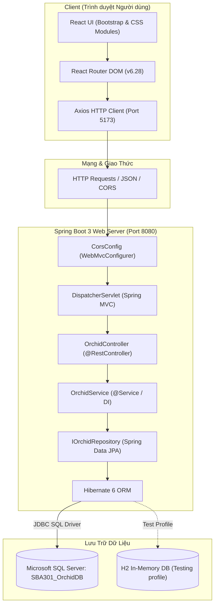
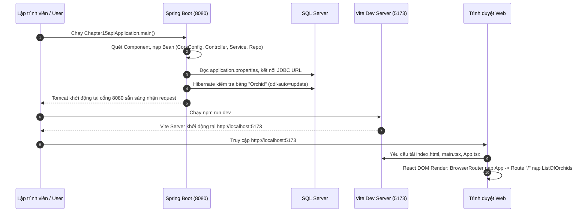
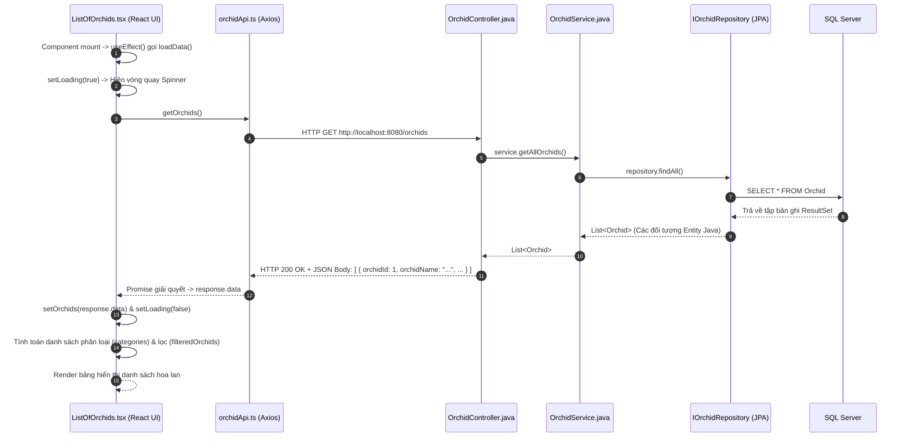
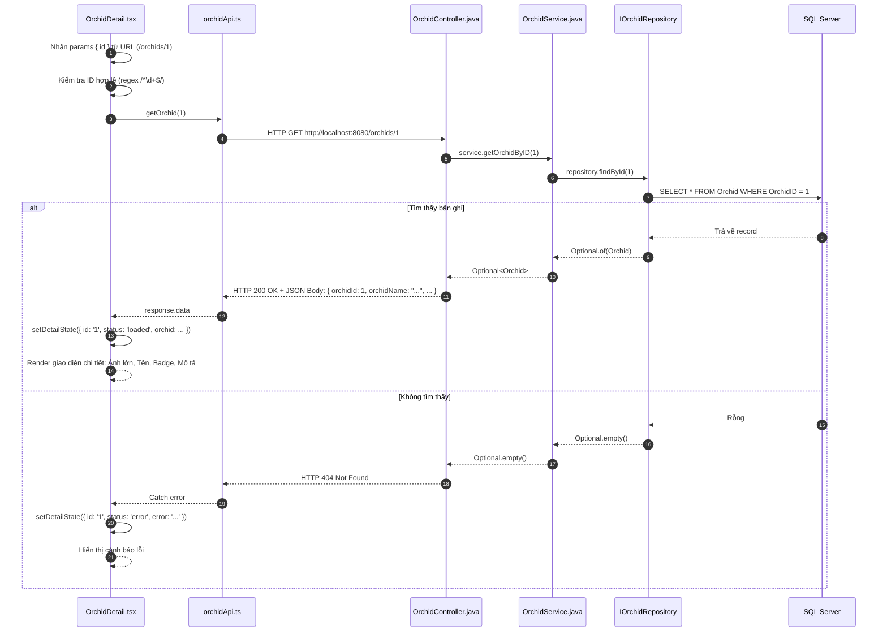
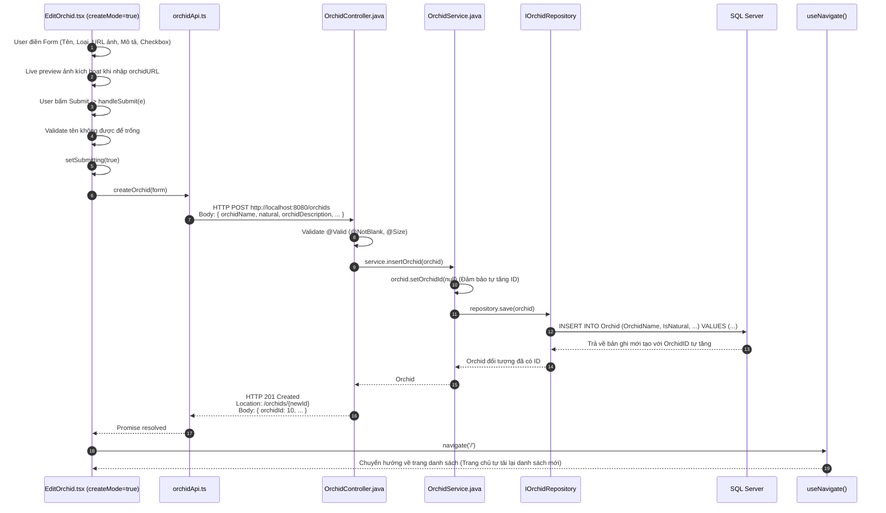
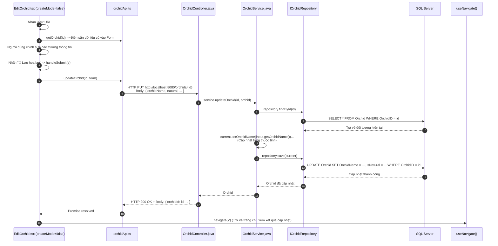
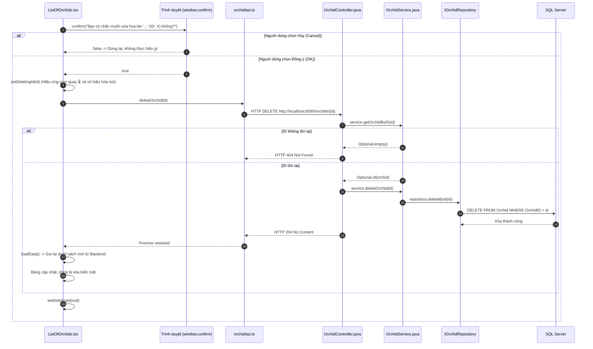

# BÁO CÁO PHÂN TÍCH TOÀN DIỆN LUỒNG HOẠT ĐỘNG DỰ ÁN ORCHID MANAGEMENT (LAB 05 - SBA301)

> **Mục tiêu tài liệu**: Giải thích chi tiết **Tại sao hệ thống chạy**, **Nó chạy ra sao** (luồng dữ liệu từ Front-end tới Back-end và Database) và **Chỗ code nào thực thi** (ánh xạ chính xác từng dòng mã nguồn, phương thức, lớp).

---

## MỤC LỤC
1. [Tổng Quan Kiến Trúc Hệ Thống (Architecture Overview)](#1-tổng-quan-kiến-trúc-hệ-thống)
2. [Tại Sao Hệ Thống Chạy Được? (Nguyên Lý Nền Tảng)](#2-tại-sao-hệ-thống-chạy-được)
   - 2.1. Phía Backend (Spring Boot 3)
   - 2.2. Phía Frontend (React 18 + Vite)
   - 2.3. Cầu nối giao tiếp (REST API, CORS & JSON Serialization)
3. [Nó Chạy Ra Sao? (Phân Tích Chi Tiết Từng Luồng Nghiệp Vụ)](#3-nó-chạy-ra-sao-chi-tiết-từng-luồng)
   - 3.1. Luồng 1: Khởi động hệ thống (System Bootstrapping)
   - 3.2. Luồng 2: Xem danh sách hoa lan (Read All / GET)
   - 3.3. Luồng 3: Xem chi tiết hoa lan (Read One / GET by ID)
   - 3.4. Luồng 4: Thêm hoa lan mới (Create / POST)
   - 3.5. Luồng 5: Chỉnh sửa hoa lan (Update / PUT)
   - 3.6. Luồng 6: Xóa hoa lan (Delete / DELETE)
4. [Bản Đồ Code Thực Thi (Code Mapping Chi Tiết)](#4-bản-đồ-code-thực-thi)
   - 4.1. Bảng ánh xạ Endpoint - Frontend Action - Backend Controller - Service - Database
   - 4.2. Chi tiết mã nguồn từng file Backend
   - 4.3. Chi tiết mã nguồn từng file Frontend
5. [Các Điểm Kỹ Thuật Đáng Chú Ý Trong Project](#5-các-điểm-kỹ-thuật-đáng-chú-ý)
6. [Tóm Tắt & Kết Luận](#6-tóm-tắt--kết-luận)

---

## 1. TỔNG QUAN KIẾN TRÚC HỆ THỐNG

Dự án **Orchid Management v5** được xây dựng theo mô hình **Single Page Application (SPA) kết hợp RESTful API** đa tầng (Multi-tier Architecture):



- **Frontend (Tầng Trình Diễn)**: Ứng dụng React viết bằng TypeScript, đóng gói bằng Vite, chạy tại cổng `http://localhost:5173`.
- **Backend (Tầng Nghiệp Vụ & API)**: Ứng dụng Spring Boot 3 viết bằng Java 21, quản trị bằng Maven, chạy tại cổng `http://localhost:8080`.
- **Database (Tầng Lưu Trữ)**: Cơ sở dữ liệu Microsoft SQL Server lưu trữ bảng dữ liệu `Orchid`. Ngoài ra cấu hình H2 In-Memory Database cho Unit & Integration Test.

---

## 2. TẠI SAO HỆ THỐNG CHẠY ĐƯỢC?

Để hiểu tại sao code viết ra lại chạy được trơn tru, ta phân tích các cơ chế cốt lõi ở cả hai phía:

### 2.1. Phía Backend (Spring Boot 3)

1. **Cơ chế Inversion of Control (IoC) & Dependency Injection (DI)**:
   - Khi chạy ứng dụng, Annotation `@SpringBootApplication` trong file `Chapter15apiApplication.java` tự động quét (Component Scanning) toàn bộ package `fu.se.chapter15api`.
   - Spring IoC Container khởi tạo các Bean:
     - `@Repository`: `IOrchidRepository` (được Spring Data JPA sinh mã proxy động).
     - `@Service`: `OrchidService` được đưa vào container và tiêm (inject) `IOrchidRepository` qua constructor.
     - `@RestController`: `OrchidController` được đưa vào container và tiêm `IOrchidService` qua constructor.
   - **Tại sao chạy được?** Vì các lớp không tự khởi tạo phụ thuộc bằng toán tử `new`, mà Spring tự quản lý vòng đời và móc nối chúng lại với nhau (Loose Coupling).

2. **Cơ chế Object-Relational Mapping (ORM) với Hibernate & JPA**:
   - Class `Orchid.java` được đánh dấu `@Entity` và `@Table(name = "Orchid")`.
   - Hibernate tự động phân tích cấu trúc lớp này để ánh xạ với bảng `Orchid` trong SQL Server.
   - Thuộc tính `spring.jpa.hibernate.ddl-auto=update` trong `application.properties` ra lệnh cho Hibernate tự kiểm tra schema bảng trong CSDL và cập nhật nếu thiếu cột.
   - Khóa chính `orchidId` được đánh dấu `@Id` và `@GeneratedValue(strategy = GenerationType.IDENTITY)`, tương ứng với cột `IDENTITY(1,1)` tự tăng trong SQL Server.

3. **Cơ chế Spring Data JPA Proxy**:
   - Interface `IOrchidRepository` kế thừa `JpaRepository<Orchid, Integer>` mà **không cần viết một dòng code hiện thực hóa (implementation) nào**.
   - **Tại sao chạy được?** Spring Data JPA tự động sinh ra một Dynamic Proxy Class tại thời điểm runtime, cung cấp sẵn các hàm chuẩn: `findAll()`, `findById()`, `save()`, `deleteById()`, `existsById()`.

4. **Xử lý đặc biệt cho kiểu dữ liệu Boolean & Jackson**:
   - Trong SQL Server, các cột `IsNatural` và `IsAttractive` là kiểu `BIT` (0 hoặc 1).
   - Trong Java, chúng là `boolean` (`natural`, `attractive`).
   - Getter cho boolean thường có tên là `isNatural()` hoặc `getIsNatural()`. Theo chuẩn JavaBeans, Jackson khi serialize ra JSON có thể bị nhầm lẫn giữa tên trường `isNatural` và `natural`.
   - Trong code, lập trình viên đã dùng:
     ```java
     @Column(name = "IsNatural", nullable = false)
     @JsonProperty("natural")
     @JsonAlias({"isNatural", "natural"})
     private boolean natural;
     ```
     Nhờ vậy, Jackson giải mã chính xác cả khi Frontend gửi lên `{ "natural": true }` hoặc `{ "isNatural": true }`.

### 2.2. Phía Frontend (React 18 + Vite)

1. **Client-side Routing (Điều hướng không tải lại trang)**:
   - File `main.tsx` bọc toàn bộ ứng dụng trong `<BrowserRouter>`.
   - `App.tsx` định nghĩa bảng Route:
     - `/` -> `<ListOfOrchids />`
     - `/orchids/new` -> `<EditOrchid createMode />`
     - `/orchids/:id/edit` -> `<EditOrchid />`
     - `/orchids/:id` -> `<OrchidDetail />`
   - **Tại sao chạy được?** React Router bắt chặn các sự kiện click trên link (`<Link to="...">`), sử dụng HTML5 History API (`pushState`) để thay đổi URL trên thanh địa chỉ và hoán đổi component hiển thị mà không bao giờ tải lại toàn bộ trang web (Zero full-page reload).

2. **React Component Lifecycle & Hooks**:
   - `useState`: Lưu trữ trạng thái giao diện (danh sách hoa lan, form nhập liệu, loading, thông báo lỗi).
   - `useEffect`: Kích hoạt side-effect (gọi API lấy dữ liệu) ngay khi component được render lần đầu (`mount`).
   - Khi state thay đổi qua hàm `set...`, React kích hoạt cơ chế Virtual DOM Reconcilation để vẽ lại đúng những phần giao diện bị thay đổi.

3. **Axios Client**:
   - File `orchidApi.ts` tạo một instance Axios tập trung với `baseURL` đọc từ biến môi trường Vite (`import.meta.env.VITE_API_URL || 'http://localhost:8080/orchids'`).
   - Axios trả về các JavaScript `Promise`, cho phép code sử dụng cú pháp `async/await` hiện đại, xử lý lỗi bằng `try/catch`.

### 2.3. Cầu Nối Giao Tiếp (CORS Negotiation & REST Protocol)

- **Tại sao Frontend ở cổng 5173 gọi được Backend ở cổng 8080 mà không bị lỗi bảo mật Same-Origin Policy (SOP)?**
  - Trình duyệt mặc định chặn các request AJAX/Fetch qua cổng khác (cross-origin).
  - Trước khi gửi các request như `POST`, `PUT`, `DELETE`, trình duyệt tự động gửi một request thăm dò gọi là **HTTP OPTIONS Preflight**.
  - Phía Backend có file cấu hình:
    ```java
    // CorsConfig.java
    @Configuration
    public class CorsConfig implements WebMvcConfigurer {
        @Override
        public void addCorsMappings(CorsRegistry registry) {
            registry.addMapping("/**")
                    .allowedOrigins("http://localhost:5173", "http://127.0.0.1:5173", "http://localhost:3000")
                    .allowedMethods("GET", "POST", "PUT", "DELETE", "OPTIONS")
                    .allowedHeaders("*");
        }
    }
    ```
  - Khi nhận OPTIONS request, Spring Boot trả về các HTTP Header:
    - `Access-Control-Allow-Origin: http://localhost:5173`
    - `Access-Control-Allow-Methods: GET, POST, PUT, DELETE, OPTIONS`
  - Nhận được header này, trình duyệt xác nhận an toàn và cho phép request thực sự đi tiếp.

---

## 3. NÓ CHẠY RA SAO? (CHI TIẾT TỪNG LUỒNG)

Dưới đây là phân tích chi tiết từng bước (step-by-step) của toàn bộ 6 luồng hoạt động chính.

---

### 3.1. Luồng 1: Khởi động hệ thống (System Bootstrapping)



- **Bước 1**: Khởi động Backend `Chapter15apiApplication`. Spring Boot nhúng máy chủ Tomcat tại port `8080`, nạp cấu hình `application.properties`, kết nối CSDL SQL Server `SBA301_OrchidDB` qua `mssql-jdbc`.
- **Bước 2**: Khởi động Frontend Vite. Khi người dùng mở trình duyệt vào `http://localhost:5173`, file `index.html` tải script `main.tsx`. React gắn component gốc `<App />` vào thẻ `<div id="root"></div>`.
- **Bước 3**: Router nhận diện URL hiện tại là `/` nên render component `<ListOfOrchids />`.

---

### 3.2. Luồng 2: Xem danh sách hoa lan (Read All / GET /orchids)

Đây là luồng người dùng nhìn thấy khi vừa mở trang chủ.



#### Các đoạn code chạy:
1. **Frontend**:
   - `ListOfOrchids.tsx:L31-L33`:
     ```typescript
     useEffect(() => {
       loadData();
     }, []);
     ```
   - `ListOfOrchids.tsx:L14-L29`: Hàm `loadData` set `loading = true`, gọi `getOrchids()`.
   - `orchidApi.ts:L9`: `api.get<Orchid[]>('')` gửi request GET tới URL rỗng tương đương `http://localhost:8080/orchids`.
2. **Backend**:
   - `OrchidController.java:L23-L26`:
     ```java
     @GetMapping({"", "/"})
     public ResponseEntity<List<Orchid>> fetchAll() {
         return ResponseEntity.ok(service.getAllOrchids());
     }
     ```
   - `OrchidService.java:L20-L22`:
     ```java
     @Override
     public List<Orchid> getAllOrchids() {
         return repository.findAll();
     }
     ```
   - `IOrchidRepository.java:L8`: Kế thừa `JpaRepository`, tự động chạy câu lệnh SQL:
     ```sql
     SELECT OrchidID, OrchidName, IsNatural, OrchidDescription, OrchidCategory, IsAttractive, OrchidURL FROM Orchid;
     ```
3. **Phản hồi & Render**:
   - Dữ liệu trả về Frontend. `setOrchids(response.data)` kích hoạt tính toán:
     - `ListOfOrchids.tsx:L54-L64`: Tự động trích xuất danh sách Category duy nhất để điền vào dropdown lọc, đồng thời lọc dữ liệu theo ô tìm kiếm `searchTerm`.
     - `ListOfOrchids.tsx:L156-L264`: Bảng HTML hiển thị danh sách, ảnh đại diện thumbnail, các badge đặc tính và các nút hành động (Chi tiết, Sửa, Xóa).

---

### 3.3. Luồng 3: Xem chi tiết hoa lan (Read One / GET /orchids/{id})

Khi người dùng nhấn vào tên hoa lan hoặc nút **"👁️ Chi tiết"**.



#### Các đoạn code chạy:
1. **Frontend**:
   - `OrchidDetail.tsx:L11`: `const { id } = useParams<{ id: string }>();` lấy tham số từ URL.
   - `OrchidDetail.tsx:L23-L38`: Gọi `getOrchid(id)`.
   - `orchidApi.ts:L10`: `export const getOrchid = (id: string | number) => api.get<Orchid>(`/${id}`);`.
2. **Backend**:
   - `OrchidController.java:L28-L33`:
     ```java
     @GetMapping("/{id}")
     public ResponseEntity<Orchid> getById(@PathVariable int id) {
         return service.getOrchidByID(id)
                 .map(ResponseEntity::ok)
                 .orElseGet(() -> ResponseEntity.notFound().build());
     }
     ```
   - `OrchidService.java:L30-L32`: Gọi `repository.findById(orchidID)`.
   - Nếu tồn tại, Spring trả về `200 OK`. Nếu rỗng, trả về `404 Not Found`.

---

### 3.4. Luồng 4: Thêm hoa lan mới (Create / POST /orchids)

Khi người dùng nhấn nút **"✨ Thêm hoa lan mới"** trên Navbar hoặc Header, nhập dữ liệu và nhấn **"💾 Lưu hoa lan"**.



#### Các đoạn code chạy:
1. **Frontend**:
   - `EditOrchid.tsx:L56-L66`: Hàm `handleChange` lắng nghe mọi thao tác nhập liệu của người dùng, phân loại xử lý checkbox (`e.target.checked`) và text input (`e.target.value`), lưu vào state `form`.
   - `EditOrchid.tsx:L68-L93`: Hàm `handleSubmit`:
     ```typescript
     if (createMode) {
       await createOrchid(form);
     }
     navigate('/');
     ```
   - `orchidApi.ts:L11`: `export const createOrchid = (orchid: OrchidDraft) => api.post<Orchid>('', orchid);`.
2. **Backend**:
   - `OrchidController.java:L35-L40`:
     ```java
     @PostMapping({"", "/"})
     public ResponseEntity<Orchid> saveOrchid(@Valid @RequestBody Orchid orchid) {
         Orchid created = service.insertOrchid(orchid);
         URI location = URI.create("/orchids/" + created.getOrchidId());
         return ResponseEntity.created(location).body(created);
     }
     ```
   - `OrchidService.java:L40-L43`:
     ```java
     @Override
     public Orchid insertOrchid(Orchid orchid) {
         orchid.setOrchidId(null); // Tránh trường hợp client tự ý truyền ID
         return repository.save(orchid);
     }
     ```
   - Database thực thi lệnh `INSERT` và phát sinh Identity ID mới.
   - Controller trả về mã HTTP `201 Created` kèm header `Location`.

---

### 3.5. Luồng 5: Chỉnh sửa hoa lan (Update / PUT /orchids/{id})

Khi người dùng nhấn **"✏️ Sửa"** trên một dòng hoa lan (URL `/orchids/:id/edit`).



#### Các đoạn code chạy:
1. **Giai đoạn tải thông tin cũ**:
   - `EditOrchid.tsx:L28-L54`: `useEffect` kiểm tra `if (!createMode && id)`, gọi `getOrchid(id)`. Khi có data, gọi `setForm(...)` để điền trước các ô input.
2. **Giai đoạn cập nhật**:
   - `EditOrchid.tsx:L80-L82`: `await updateOrchid(Number(id), form);`.
   - `orchidApi.ts:L12-L13`: `api.put<Orchid>(`/${id}`, orchid)`.
3. **Backend xử lý**:
   - `OrchidController.java:L42-L52`:
     ```java
     @PutMapping("/{id}")
     public ResponseEntity<Orchid> updateOrchid(@PathVariable int id, @Valid @RequestBody Orchid orchid) {
         try {
             return ResponseEntity.ok(service.updateOrchid(id, orchid));
         } catch (IllegalArgumentException ex) {
             return ResponseEntity.notFound().build();
         }
     }
     ```
   - `OrchidService.java:L51-L61`:
     ```java
     @Override
     public Orchid updateOrchid(int orchidID, Orchid input) {
         Orchid current = repository.findById(orchidID)
                 .orElseThrow(() -> new IllegalArgumentException("Orchid not found: " + orchidID));
         current.setOrchidName(input.getOrchidName());
         current.setNatural(input.isNatural());
         current.setOrchidDescription(input.getOrchidDescription());
         current.setOrchidCategory(input.getOrchidCategory());
         current.setAttractive(input.isAttractive());
         current.setOrchidURL(input.getOrchidURL());
         return repository.save(current);
     }
     ```
     > **Điểm mấu chốt**: Service tìm entity trong DB trước, thay đổi các trường (Dirty Checking), sau đó gọi `save()`. Nếu ID không tồn tại trong DB, ném `IllegalArgumentException` và Controller bắt lại để trả về HTTP `404 Not Found`.

---

### 3.6. Luồng 6: Xóa hoa lan (Delete / DELETE /orchids/{id})

Khi người dùng nhấn nút **"🗑️ Xóa"** tại một dòng hoa lan trên bảng danh sách.



#### Các đoạn code chạy:
1. **Frontend**:
   - `ListOfOrchids.tsx:L35-L52`:
     ```typescript
     const handleDelete = async (id: number, name: string) => {
       if (!window.confirm(`Bạn có chắc muốn xóa hoa lan "${name}" (ID: ${id}) không?`)) {
         return;
       }
       try {
         setDeletingId(id);
         await deleteOrchid(id);
         await loadData(); // Tải lại danh sách sau khi xóa
       } catch (e) { ... }
       finally { setDeletingId(null); }
     };
     ```
   - `orchidApi.ts:L14`: `export const deleteOrchid = (id: number | string) => api.delete(`/${id}`);`.
2. **Backend**:
   - `OrchidController.java:L54-L61`:
     ```java
     @DeleteMapping("/{id}")
     public ResponseEntity<Void> deleteOrchid(@PathVariable int id) {
         if (service.getOrchidByID(id).isEmpty()) {
             return ResponseEntity.notFound().build(); // 404 nếu không có
         }
         service.deleteOrchid(id);
         return ResponseEntity.noContent().build(); // 204 No Content chuẩn REST
     }
     ```
   - `OrchidService.java:L77-L79`:
     ```java
     @Override
     public void deleteOrchid(int orchidID) {
         repository.deleteById(orchidID);
     }
     ```

---

## 4. BẢN ĐỒ CODE THỰC THI (CODE MAPPING CHI TIẾT)

### 4.1. Bảng Ánh Xạ Tổng Thể: UI - API - Controller - Service - SQL

| Thao tác người dùng | URL Frontend | Phương thức & URL Backend | Hàm Frontend gọi | Hàm Controller tiếp nhận | Hàm Service xử lý | Lệnh SQL thực thi trên CSDL |
| :--- | :--- | :--- | :--- | :--- | :--- | :--- |
| **Xem danh sách** | `/` | `GET /orchids` | `getOrchids()` trong `orchidApi.ts` | `OrchidController.fetchAll()` | `OrchidService.getAllOrchids()` | `SELECT ... FROM Orchid` |
| **Xem chi tiết** | `/orchids/:id` | `GET /orchids/{id}` | `getOrchid(id)` trong `orchidApi.ts` | `OrchidController.getById(id)` | `OrchidService.getOrchidByID(id)` | `SELECT ... FROM Orchid WHERE OrchidID = ?` |
| **Thêm hoa lan** | `/orchids/new` | `POST /orchids` | `createOrchid(data)` trong `orchidApi.ts` | `OrchidController.saveOrchid(data)` | `OrchidService.insertOrchid(data)` | `INSERT INTO Orchid (...) VALUES (...)` |
| **Sửa hoa lan** | `/orchids/:id/edit` | `PUT /orchids/{id}` | `updateOrchid(id, data)` trong `orchidApi.ts` | `OrchidController.updateOrchid(id, data)` | `OrchidService.updateOrchid(id, data)` | `UPDATE Orchid SET ... WHERE OrchidID = ?` |
| **Xóa hoa lan** | Nút bấm trên `/` | `DELETE /orchids/{id}` | `deleteOrchid(id)` trong `orchidApi.ts` | `OrchidController.deleteOrchid(id)` | `OrchidService.deleteOrchid(id)` | `DELETE FROM Orchid WHERE OrchidID = ?` |

---

### 4.2. Chi Tiết Mã Nguồn Từng File Backend

#### 1. `Chapter15apiApplication.java` (File Khởi Động)
- **Đường dẫn**: `chapter15api/src/main/java/fu/se/chapter15api/Chapter15apiApplication.java`
- **Vai trò**: Điểm bắt đầu (Entry-point) của ứng dụng Java.
- **Dòng quan trọng**:
  - `Dòng 6`: `@SpringBootApplication`: Bật tính năng Auto-configuration, Component Scan.
  - `Dòng 8-10`: `SpringApplication.run(Chapter15apiApplication.class, args);` khởi động máy chủ nhúng Tomcat.

#### 2. `CorsConfig.java` (Cấu Hình Mở Cổng CORS)
- **Đường dẫn**: `chapter15api/src/main/java/fu/se/chapter15api/configs/CorsConfig.java`
- **Vai trò**: Cho phép trình duyệt gọi API từ cổng khác (cổng Frontend 5173).
- **Dòng quan trọng**:
  - `Dòng 11-14`: Cho phép origins `http://localhost:5173`, `http://127.0.0.1:5173`, `http://localhost:3000` với các methods `GET, POST, PUT, DELETE, OPTIONS`.

#### 3. `Orchid.java` (Entity / POJO)
- **Đường dẫn**: `chapter15api/src/main/java/fu/se/chapter15api/pojos/Orchid.java`
- **Vai trò**: Đại diện cho 1 bản ghi trong bảng `Orchid` dưới database.
- **Dòng quan trọng**:
  - `Dòng 15-16`: `@Entity`, `@Table(name = "Orchid")`.
  - `Dòng 19-22`: `@Id`, `@GeneratedValue(strategy = GenerationType.IDENTITY)`, `@Column(name = "OrchidID")`.
  - `Dòng 24-27`: `@NotBlank(message = "Orchid name cannot be blank")` kiểm tra tính hợp lệ dữ liệu.
  - `Dòng 29-33` & `Dòng 42-46`: `@JsonProperty` và `@JsonAlias` giúp tương thích tuần tự hóa JSON hai chiều với Frontend.

#### 4. `IOrchidRepository.java` (Data Access Layer)
- **Đường dẫn**: `chapter15api/src/main/java/fu/se/chapter15api/repositories/IOrchidRepository.java`
- **Vai trò**: Giao tiếp trực tiếp với cơ sở dữ liệu.
- **Dòng quan trọng**:
  - `Dòng 8`: `public interface IOrchidRepository extends JpaRepository<Orchid, Integer>` kế thừa sẵn tất cả các hàm CRUD.

#### 5. `IOrchidService.java` & `OrchidService.java` (Business Logic Layer)
- **Đường dẫn**: `chapter15api/src/main/java/fu/se/chapter15api/services/`
- **Vai trò**: Chứa logic xử lý nghiệp vụ trước khi ghi vào DB hoặc trả về Controller.
- **Dòng quan trọng**:
  - `Dòng 13-17`: Constructor Injection tiêm `IOrchidRepository`.
  - `Dòng 40-43`: `insertOrchid`: Đặt `orchid.setOrchidId(null)` để đảm bảo DB tự sinh ID.
  - `Dòng 51-61`: `updateOrchid`: Tìm entity cũ, ném ngoại lệ nếu không thấy, gán giá trị mới và lưu lại.

#### 6. `OrchidController.java` (REST Controller Layer)
- **Đường dẫn**: `chapter15api/src/main/java/fu/se/chapter15api/controllers/OrchidController.java`
- **Vai trò**: Tiếp nhận HTTP Request từ Frontend, gọi Service, trả về HTTP Response tương ứng.
- **Dòng quan trọng**:
  - `Dòng 13-15`: `@RestController`, `@RequestMapping("/orchids")`.
  - `Dòng 23-26`: `fetchAll()` -> `GET /orchids`.
  - `Dòng 28-33`: `getById()` -> `GET /orchids/{id}`.
  - `Dòng 35-40`: `saveOrchid()` -> `POST /orchids`.
  - `Dòng 42-52`: `updateOrchid()` -> `PUT /orchids/{id}`.
  - `Dòng 54-61`: `deleteOrchid()` -> `DELETE /orchids/{id}`.

---

### 4.3. Chi Tiết Mã Nguồn Từng File Frontend

#### 1. `main.tsx` & `App.tsx` (Entry & Routing)
- **Đường dẫn**: `chapter15reactjs/src/main.tsx` và `App.tsx`
- **Vai trò**: Nạp React DOM, cấu hình routing SPA.
- **Dòng quan trọng**:
  - `App.tsx:L13-L18`: Định nghĩa các Route:
    - Route `/`: `<ListOfOrchids />`
    - Route `/orchids/new`: `<EditOrchid createMode />`
    - Route `/orchids/:id/edit`: `<EditOrchid />`
    - Route `/orchids/:id`: `<OrchidDetail />`

#### 2. `types.ts` & `orchidApi.ts` (Data Contract & Network Layer)
- **Đường dẫn**: `chapter15reactjs/src/types.ts` và `chapter15reactjs/src/services/orchidApi.ts`
- **Vai trò**: Định nghĩa kiểu dữ liệu TypeScript và cấu hình gọi API qua Axios.
- **Dòng quan trọng**:
  - `types.ts:L1-L18`: Interface `Orchid` và type `OrchidDraft` (bỏ `orchidId` khi tạo mới/sửa).
  - `orchidApi.ts:L4-L7`: Tạo instance Axios với baseURL trỏ về `http://localhost:8080/orchids`.
  - `orchidApi.ts:L9-L14`: 5 hàm API chuẩn REST: `getOrchids`, `getOrchid`, `createOrchid`, `updateOrchid`, `deleteOrchid`.

#### 3. `ListOfOrchids.tsx` (Màn Hình Danh Sách)
- **Đường dẫn**: `chapter15reactjs/src/components/ListOfOrchids.tsx`
- **Vai trò**: Hiển thị bảng dữ liệu hoa lan, tìm kiếm, lọc loại, xóa hoa lan.
- **Dòng quan trọng**:
  - `Dòng 14-29`: `loadData()` - Lấy dữ liệu hoa lan từ API và cập nhật state `orchids`.
  - `Dòng 35-52`: `handleDelete()` - Gọi API xóa và tải lại danh sách.
  - `Dòng 58-64`: Thuật toán lọc dữ liệu tại Client (`filteredOrchids`) kết hợp cả `searchTerm` và `filterCategory`.

#### 4. `EditOrchid.tsx` (Màn Hình Tạo Mới & Chỉnh Sửa)
- **Đường dẫn**: `chapter15reactjs/src/components/EditOrchid.tsx`
- **Vai trò**: Form nhập liệu tái sử dụng cho cả 2 thao tác Tạo mới (`createMode=true`) và Sửa (`createMode=false`).
- **Dòng quan trọng**:
  - `Dòng 28-54`: Tự động gọi API `getOrchid(id)` để đổ dữ liệu cũ vào form nếu đang ở chế độ Chỉnh sửa.
  - `Dòng 56-66`: `handleChange()` xử lý 2 loại input: Text và Checkbox Switch.
  - `Dòng 68-93`: `handleSubmit()` gửi dữ liệu lên Backend và điều hướng về trang chủ (`navigate('/')`).
  - `Dòng 180-200`: Tính năng xem trước hình ảnh trực tiếp (Live Image Preview).

#### 5. `OrchidDetail.tsx` (Màn Hình Chi Tiết)
- **Đường dẫn**: `chapter15reactjs/src/OrchidDetail.tsx`
- **Vai trò**: Hiển thị toàn bộ thông tin chi tiết của 1 hoa lan dưới dạng thẻ bài (Card) sang trọng.
- **Dòng quan trọng**:
  - `Dòng 14-43`: `useEffect` lắng nghe thay đổi của `id`, gọi `getOrchid(id)` có cơ chế dọn dẹp bộ nhớ (cleanup flag `active = false`) chống Memory Leak khi component unmount đột ngột.

---

## 5. CÁC ĐIỂM KỸ THUẬT ĐÁNG CHÚ Ý

1. **Khử bất đồng bộ và chống rò rỉ bộ nhớ (Race Condition & Memory Leak)**:
   - Trong `OrchidDetail.tsx:L15-L42`, cờ `let active = true` được sử dụng bên trong `useEffect`. Nếu người dùng nhấn back trước khi request hoàn tất, hàm cleanup sẽ đặt `active = false`, ngăn không cho gọi `setDetailState` khi component đã unmount.
2. **Client-side Filtering tối ưu hóa trải nghiệm (UX Performance)**:
   - Thay vì mỗi lần người dùng gõ 1 ký tự vào ô tìm kiếm lại gửi 1 request về server (gây quá tải DB), `ListOfOrchids.tsx` tải toàn bộ danh sách một lần và lọc trực tiếp trên bộ nhớ trình duyệt qua mảng `filteredOrchids`.
3. **Mã trạng thái HTTP chuẩn RESTful**:
   - Thành công thông thường: `200 OK`
   - Tạo mới thành công: `201 Created` kèm theo đường dẫn tài nguyên mới tại Header `Location`
   - Xóa thành công: `204 No Content` (không có body thừa)
   - Không tìm thấy tài nguyên: `404 Not Found`
4. **Validation đa tầng (Multi-layer Validation)**:
   - **Frontend**: Kiểm tra `form.orchidName.trim()` trước khi submit, đánh dấu trường bắt buộc trên giao diện (`required`, `*`).
   - **Backend**: Sử dụng bean validation `@NotBlank`, `@Size` trên Entity kết hợp `@Valid` tại Controller. Nếu vi phạm, Spring sẽ từ chối ngay lập tức với mã lỗi `400 Bad Request`.

---

## 6. TÓM TẮT & KẾT LUẬN

Hệ thống **Orchid Management v5** hoạt động nhờ vào sự phối hợp nhịp nhàng giữa:
1. **Frontend React Vite**: Chịu trách nhiệm về giao diện, thu thập sự kiện người dùng, điều hướng SPA mượt mà và gửi các request HTTP qua Axios.
2. **Giao thức REST / CORS**: Đóng vai trò cầu nối dữ liệu JSON an toàn giữa cổng 5173 và 8080.
3. **Backend Spring Boot 3**: Đóng vai trò bộ não nghiệp vụ, nhận request tại Controller, xử lý logic tại Service và dùng Spring Data JPA để thao tác với SQL Server.
4. **Database SQL Server**: Đảm bảo lưu trữ dữ liệu bền vững, tự động phát sinh khóa chính IDENTITY.

Tất cả các thành phần được thiết kế theo đúng nguyên lý tách biệt mối quan tâm (**Separation of Concerns**), giúp mã nguồn dễ đọc, dễ bảo trì và mở rộng trong tương lai.
